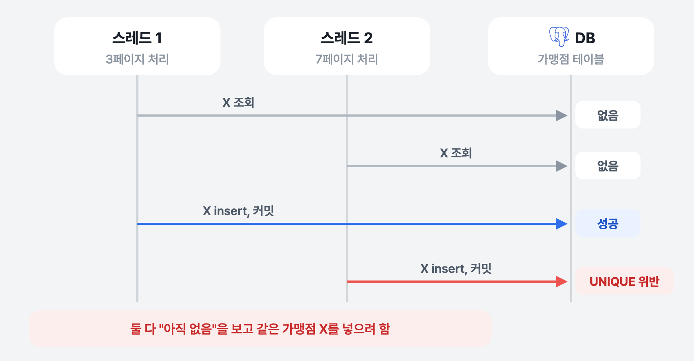
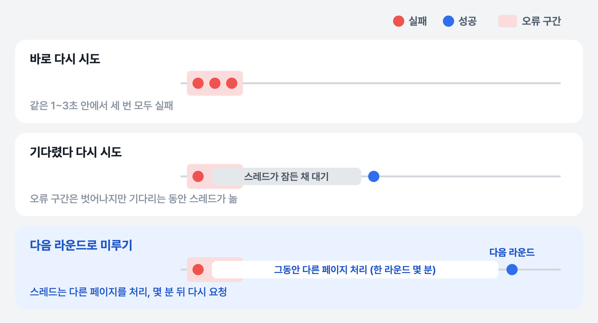

[1편](../gwpass-sync-parallel/)에서 가맹점 동기화의 작업 단위를 (지역, 페이지)로 나눠 여러 스레드가 동시에 처리하게 바꿨습니다. 이번 글은 그 구조로 실제 데이터를 처음 끝까지 돌렸을 때 생긴 두 가지 문제입니다. 하나는 우리 DB 안에서 생긴 충돌이고, 하나는 외부 API에서 오는 오류입니다.

## 문제: 25분 만에 실패

실제 데이터가 들어 있는 RDS 테스트 DB에서 돌리자, 페이지 약 237개 중 **43개(약 18%)** 에서 두 종류의 오류가 났습니다.

- 가맹점 고유 번호(`external_id`)의 UNIQUE 제약 위반
- PostgreSQL 데드락

그리고 25분 뒤 동기화가 실패로 끝났습니다.

## 원인: 같은 가맹점이 두 페이지에 나온다

가맹점 저장은 "고유 번호로 이미 있는지 찾아보고, 있으면 고치고 없으면 새로 넣는" 방식입니다. 한 번에 한 페이지만 처리할 때는 문제가 없었습니다.

문제는 이 API의 **페이지 구성이 고정되어 있지 않다**는 점이었습니다. 같은 시군을 페이지로 넘기며 받는 동안 순서가 바뀌어, **같은 가맹점이 서로 다른 두 페이지에 나오는** 경우가 있었습니다. 페이지를 순서대로 처리할 때는 두 번째로 나온 쪽이 "이미 있음 → 고침"이 되니 드러나지 않았습니다. 그런데 두 페이지가 동시에 처리되면 이렇게 됩니다.



*두 스레드가 동시에 "아직 없음"을 보고 같은 가맹점을 넣는다*

두 스레드가 거의 같은 때에 조회해서 둘 다 "아직 없음"을 보고, 둘 다 넣으려고 합니다. 늦은 쪽은 UNIQUE 제약에 걸립니다. 한 페이지에는 가맹점이 최대 1,000건이라 두 페이지가 겹치는 가맹점이 여러 개일 수 있습니다. 이때 두 트랜잭션이 고유 번호 인덱스의 같은 값들을 서로 다른 순서로 잡으면 서로를 기다리게 되고, PostgreSQL은 이를 데드락으로 판단해 한쪽을 끊습니다. 로그에 찍힌 데드락은 공유 인덱스에서 난 것이었습니다.

## 해결 1: 저장만 다시 시도한다

충돌이 나면 그 페이지의 **저장만** 다시 시도하게 했습니다.

- **API는 다시 부르지 않습니다.** 이미 받아서 파싱한 페이지 데이터를 그대로 씁니다. 문제는 DB에서 생겼으니 외부 호출을 늘릴 이유가 없습니다.
- **다시 시도할 때 기존 가맹점을 다시 조회합니다.** 그 사이 상대 스레드가 커밋했다면 X는 이제 "이미 있음"이 되어, 실패했던 insert가 **자연스럽게 update로 바뀝니다.**
- **50~200ms 사이 무작위로 기다린 뒤** 다시 시도합니다. 부딪힌 두 스레드가 같은 시간만큼 기다리면 다시 동시에 부딪힐 수 있어서, 기다리는 시간을 서로 다르게 했습니다.
- 최대 3번까지 시도하고, 그래도 실패하면 다른 실패와 같은 예외로 올립니다.

```java
private PageApplyResult applyPage(JsonNode data) {
    for (int attempt = 1; attempt <= MAX_ATTEMPTS; attempt++)
        try {
            // 조회 → insert/update 판단 → 저장을 한 트랜잭션으로. 다시 시도하면 조회부터 새로 한다
            return transactionTemplate.execute(status -> applyPageWithinTransaction(data));
        } catch (DataIntegrityViolationException | ConcurrencyFailureException e) {
            if (attempt == MAX_ATTEMPTS) throw externalError("가맹점 페이지 저장에 실패했습니다");
            Thread.sleep(50 + ThreadLocalRandom.current().nextInt(151));   // 50~200ms (인터럽트 처리 생략)
        }
}
```

UNIQUE 위반은 `DataIntegrityViolationException`으로, 데드락은 `ConcurrencyFailureException` 계열로 올라와서 두 예외를 함께 잡았습니다.

이게 가능한 건 저장이 **가맹점 고유 번호 기준으로 넣거나 고치는(upsert)** 방식이기 때문입니다. 같은 페이지를 몇 번 다시 저장해도, 같은 가맹점이 두 페이지에 나와도 결과는 가맹점 한 줄입니다. 그래서 "실패하면 다시 하면 된다"가 성립합니다.

## 또 하나의 실패: 몰려서 오는 외부 API 오류

저장 충돌을 잡고 나니, 남은 실패는 외부 API 쪽이었습니다. 1편에서 말한 비정상 응답과 가끔 오는 HTTP 504입니다. 이미 페이지마다 3번까지 다시 요청하고 있었는데도 실패가 남았습니다.

로그를 보니 이 오류들은 특정 페이지와 상관없이 **1~3초 정도의 짧은 구간에 몰려서** 왔습니다. 외부 서버가 잠깐 불안정한 순간이 있고, 그 순간에 요청한 페이지들이 한꺼번에 실패하는 모양이었습니다. 그렇다면 다시 시도하는 **때**가 중요합니다.



*실패한 페이지를 언제 다시 요청할까*

| 방법 | 오류 구간을 벗어나나 | 단점 |
|---|---|---|
| 바로 다시 시도 (기존) | 못 벗어남 — 같은 1~3초 안에서 다시 실패 | 세 번 다 버려짐 |
| 기다렸다 다시 시도 (백오프) | 벗어남 | 기다리는 동안 **스레드가 놀아서** 동시 처리 수 8이 줄어드는 효과 |
| **다음 라운드로 미루기** | 벗어남 — 몇 분 뒤에 다시 시도 | 라운드를 관리하는 코드가 늘어남 |

마지막 방법을 골랐습니다. 페이지 처리를 최대 3라운드로 나누고, 한 라운드에서 실패한 페이지만 모아 다음 라운드에서 다시 처리합니다. 페이지 약 250개를 한 바퀴 도는 데 몇 분이 걸리기 때문에, 미뤄진 페이지는 **스레드를 재우지 않고도** 관찰한 오류 구간(1~3초)보다 훨씬 긴 간격을 두고 다시 요청됩니다.

이렇게 하려고 페이지 작업이 실패하면 예외를 던지는 대신 **결과 객체에 실패를 담아 돌려주게** 바꿨습니다. 예외로 끝내면 라운드가 끝났을 때 어떤 페이지가 실패했는지 모으기 어렵기 때문입니다. 3라운드가 지나도 실패하는 페이지가 남으면 그때 동기화를 실패로 끝냅니다.

## 바뀐 점

| | 바꾸기 전 | 바꾼 후 |
|---|---|---|
| 같은 가맹점 동시 insert | UNIQUE 위반·데드락으로 실패 | 저장만 다시 시도, 진 쪽은 update로 바뀜 |
| 다시 시도할 때 API | — | 다시 부르지 않음 (받은 데이터 재사용) |
| 몰려서 오는 API 오류 | 같은 구간에서 3번 다 실패 | 다음 라운드(몇 분 뒤)에 다시 요청 |
| 실패 판단 | 페이지 하나만 실패해도 전체 실패 | 3라운드 뒤에도 남은 페이지가 있을 때만 실패 |

## 남은 것

**DB가 충돌을 처리하게 할 수도 있습니다.** PostgreSQL의 `INSERT ... ON CONFLICT (external_id) DO UPDATE`를 쓰면 UNIQUE 충돌 자체가 예외가 되지 않습니다. 이번에는 JPA로 조회 → 판단 → 저장하는 기존 흐름을 유지하고 그 위에 재시도를 얹었는데, 충돌이 잦아지면 이쪽이 더 간단할 수 있습니다.

**충돌은 없어지지 않았고, 처리될 뿐입니다.** API 페이지가 흔들리는 한 같은 가맹점이 두 페이지에 나오는 일은 계속 생깁니다. 다시 시도하는 비용이 작아서 이 정도로 충분하다고 봤습니다.

그리고 충돌을 고친 뒤에도 **저장 자체가 느렸습니다.** 페이지 하나 저장에 평균 9초가 넘게 걸렸는데, 원인은 엔티티 ID를 만드는 방식에 있었습니다. 3편에서 다룹니다.

## 정리

- 순서대로 처리할 때는 숨어 있던 데이터 특성(같은 가맹점이 두 페이지에 나옴)이 **병렬로 바꾸자 충돌로 드러났습니다.**
- 저장이 고유 번호 기준 upsert라 **다시 시도해도 결과가 같습니다.** 그래서 충돌이 나면 저장만 다시 하고, 다시 할 때 조회부터 새로 해서 insert를 update로 바꿨습니다.
- 외부 오류가 몰려서 온다면 **언제 다시 시도하느냐**가 중요합니다. 스레드를 재우는 대신 실패한 페이지를 다음 라운드로 미뤄 자연스럽게 시간 간격을 벌었습니다.
