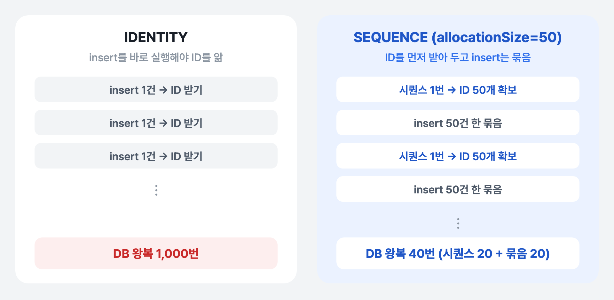
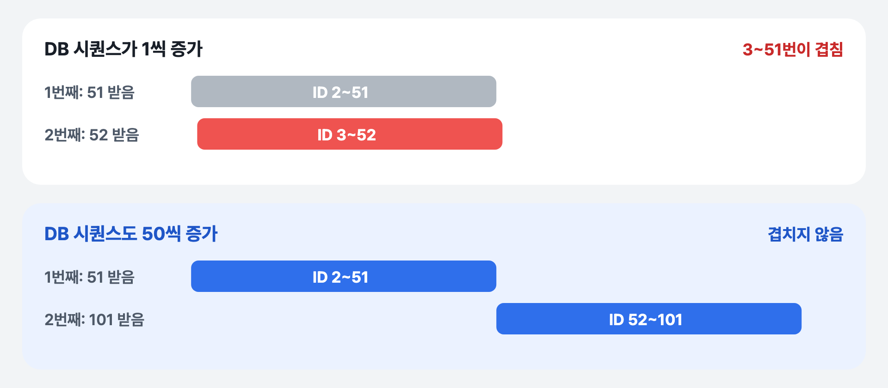

[2편](../gwpass-sync-conflict/)에서 병렬 저장 충돌을 다시 시도로 풀었습니다. 동기화는 끝까지 돌게 됐지만, 페이지별 구간 시간 로그를 보니 **저장(saveMs)이 평균 9,278ms**나 걸리고 있었습니다. 페이지 하나에 가맹점이 최대 1,000건이니 적은 양은 아니지만, 9초는 너무 길었습니다. 로그에는 가맹점 고유 번호 인덱스(`merchants_external_id_key`)에서 락을 기다리는 모습도 보였습니다.

## 설정은 되어 있었다

대량 저장이 느릴 때 먼저 보는 설정은 JDBC 배치입니다. insert를 한 건씩 DB에 보내지 않고 여러 건을 묶어 한 번에 보내게 하는 설정인데, 이미 켜 두었습니다.

```yaml
spring.jpa.properties:
  hibernate.jdbc.batch_size: 50
  hibernate.order_inserts: true
  hibernate.order_updates: true
```

그런데 가맹점 엔티티의 ID 생성 전략이 `IDENTITY`였습니다.

```java
@Id
@GeneratedValue(strategy = GenerationType.IDENTITY)
private Long id;
```

**`IDENTITY` 전략에서는 Hibernate가 insert를 묶어 보낼 수 없습니다.** `batch_size`를 얼마로 정해도 마찬가지입니다.

## 왜 IDENTITY에서는 배치가 안 될까

JPA는 `save()`한 엔티티를 영속성 컨텍스트에 ID로 등록해 둡니다. 그러려면 저장하는 순간 ID를 알아야 합니다.

- **`IDENTITY`** 는 ID를 DB가 insert하면서 정합니다(PostgreSQL에서는 `BIGSERIAL`). 그래서 Hibernate는 ID를 알기 위해 **insert를 그 자리에서 바로 실행하고 결과로 ID를 받아 와야** 합니다. 모았다가 나중에 한 번에 보낼 수가 없습니다.
- **`SEQUENCE`** 는 insert 전에 시퀀스에서 ID를 먼저 받아 올 수 있습니다. ID를 미리 정해 두었으니 insert는 모아 두었다가 `batch_size`만큼 묶어서 보낼 수 있습니다.



*가맹점 1,000건을 새로 넣을 때 DB와 오가는 횟수*

`SEQUENCE`라도 ID 하나마다 시퀀스를 부르면 그 왕복이 새로 생깁니다. 그래서 `allocationSize`로 **한 번 부를 때 ID를 몇 개 받아 둘지** 정합니다. 50으로 두면 시퀀스를 한 번 부를 때마다 ID 50개를 쓸 수 있습니다.

## 바꾼 것

가맹점 엔티티를 `SEQUENCE`로 바꿨습니다. 테이블을 만들 때 `BIGSERIAL`이 이미 만들어 둔 시퀀스(`merchants_id_seq`)를 그대로 쓰고, `allocationSize`는 `batch_size`와 같은 50으로 맞췄습니다.

```java
@Id
@GeneratedValue(strategy = GenerationType.SEQUENCE, generator = "merchants_seq")
@SequenceGenerator(name = "merchants_seq", sequenceName = "merchants_id_seq", allocationSize = 50)
private Long id;
```

그리고 DB 시퀀스의 증가값도 50으로 바꾸는 마이그레이션을 추가했습니다.

```sql
ALTER SEQUENCE merchants_id_seq INCREMENT BY 50;
```

### 시퀀스 증가값도 50이어야 하는 이유

`allocationSize`만 50으로 바꾸고 DB 시퀀스는 1씩 증가하게 두면 ID가 겹칠 수 있습니다.

Hibernate는 `allocationSize`가 1보다 크면 **시퀀스 값 하나를 받을 때마다 "여기까지 50개는 내 것"이라고 계산**해서 그 범위의 ID를 메모리에서 나눠 씁니다. 이 계산은 DB 시퀀스도 50씩 증가한다는 가정 위에 있습니다. 시퀀스가 1씩만 증가하면 다음 호출은 바로 다음 숫자를 돌려주고, 그 숫자로 계산한 범위는 앞에서 이미 쓰기로 한 범위와 겹칩니다.



*Hibernate가 계산하는 ID 범위와 DB 시퀀스 증가값*

동기화는 여러 스레드가 동시에 저장하니 이 부분이 특히 중요했습니다. 시퀀스를 50씩 증가하게 해 두면 `nextval()` 자체는 DB가 원자적으로 처리하므로, 여러 스레드가 동시에 불러도 각자 겹치지 않는 50개 범위를 받습니다.

### 가맹점에만 적용했다

관광지 엔티티는 `IDENTITY` 그대로 두었습니다. 저장이 느리고 락 경합이 보인 곳은 가맹점 저장이었기 때문에, 문제가 확인된 곳만 바꾸도록 범위를 좁혔습니다. 바꾼 뒤에는 Testcontainers로 실제 PostgreSQL을 띄우는 통합 테스트까지 포함해 전체 테스트를 다시 돌려 확인했습니다.

## 바뀐 점

페이지 하나 저장 시간이 평균 **9,278ms에서 40~200ms**로 줄었습니다.

| | IDENTITY | SEQUENCE (allocationSize=50) |
|---|---|---|
| ID를 정하는 때 | insert할 때 DB가 | insert 전에 시퀀스에서 |
| insert 묶어 보내기 | 불가능 (`batch_size` 무시) | `batch_size` 50건씩 |
| 새 가맹점 1,000건을 넣을 때 DB 왕복 | insert 1,000번 | 시퀀스 20번 + insert 묶음 20번 |
| 페이지 저장 시간 | 평균 9,278ms | 40~200ms |

## 남은 것

**ID에 빈 번호가 생깁니다.** 서버가 ID 50개를 받아 두고 다 쓰기 전에 재시작하면 남은 번호는 버려집니다. 가맹점 ID는 순서나 연속성에 의미가 없어서 문제 삼지 않았습니다.

**서버가 여러 대여도 괜찮지만, 시퀀스를 직접 쓰는 다른 곳이 있으면 같이 맞춰야 합니다.** SQL로 직접 `nextval()`을 부르는 코드가 있다면 그 코드도 50씩 건너뛴다는 걸 알아야 합니다.

## 정리

- `hibernate.jdbc.batch_size`를 설정해도 ID 전략이 **`IDENTITY`면 insert 배치는 동작하지 않습니다.** ID를 알려면 insert를 바로 실행해야 하기 때문입니다.
- `SEQUENCE`로 바꿀 때는 **`allocationSize`와 DB 시퀀스의 증가값을 같게** 맞춰야 ID가 겹치지 않습니다.
- 설정 파일만 보면 켜져 있는 것 같았지만, 실제로는 꺼져 있었습니다. 구간 시간 로그로 저장이 느린 것을 먼저 확인했기 때문에 찾을 수 있었습니다.
