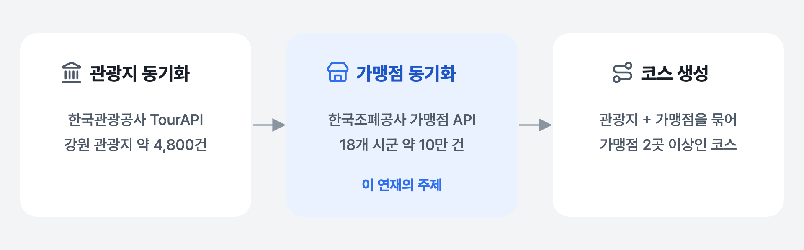
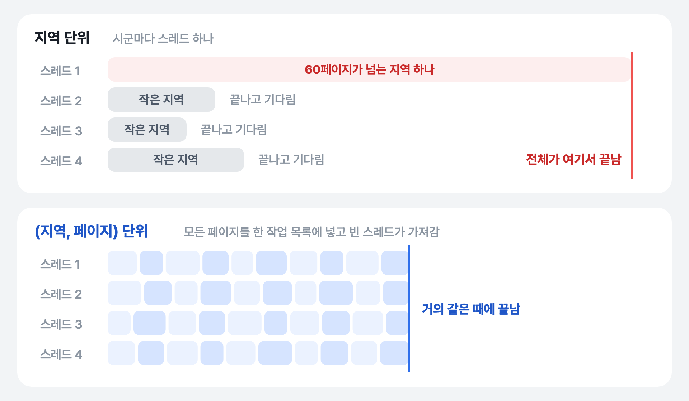
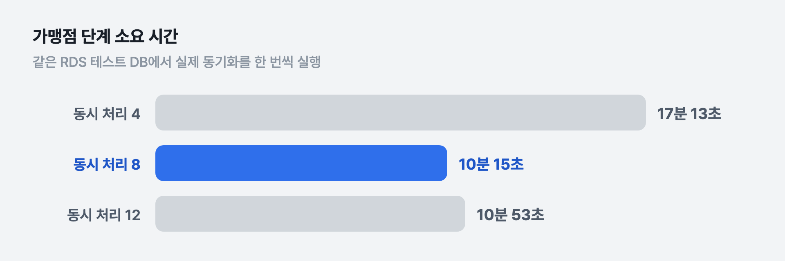

강원환급패스는 강원도 여행 코스를 추천하고, 여행 중 지역화폐 가맹점에서 쓴 영수증을 인증하면 강원상품권으로 돌려받게 해 주는 앱입니다. 2026 관광데이터 공모전에 내려고 만들었습니다. 코스를 만들려면 관광지와 가맹점 데이터가 있어야 하는데, 둘 다 공공데이터 API에서 받아 옵니다.

이 연재는 그 데이터를 받아 오는 **동기화**를 고친 기록입니다. 처음엔 끝까지 돌지도 못하던 동기화를 빠르게 만들고(1편), 병렬로 바꾸자 생긴 저장 충돌을 고치고(2·3편), 중간에 서버가 죽어도 이어서 끝나게 만든(4·5편) 순서로 씁니다.

## 동기화가 하는 일

동기화는 세 단계를 차례로 실행합니다.



*동기화 파이프라인 — 이 글은 가운데 가맹점 단계 이야기*

시간 대부분은 가운데 **가맹점 동기화**에서 씁니다. 한국조폐공사의 통합 가맹점 정보 API(공공데이터포털)에서 강원도 18개 시군의 가맹점을 시군별로, 한 번에 1,000건씩 페이지를 넘기며 받아 와 DB에 넣거나 고칩니다. 폐업했거나 좌표가 없는 가맹점, 개인택시 같은 운수업(같은 주소에 여러 건씩 등록돼 있어 코스 조건을 의미 없이 채움)을 걸러 내고 나면 약 10만 건이 남습니다.

### 이 API의 특징

API를 붙이면서 문서와 다르게 동작하는 곳이 몇 군데 있었습니다. 같은 API를 쓰는 분께 도움이 될 것 같아 적어 둡니다.

- **지역 필터는 대괄호를 인코딩하지 않고 보내야 합니다.** `cond[usage_rgn_cd::EQ]=51110`을 미리 URL 인코딩해서 보내면 서버가 필터를 무시하고 전국 데이터를 돌려줍니다.
- **`totalCount`는 필터와 상관없이 항상 전체 데이터 건수입니다.** 필터에 걸린 건수는 `matchCount`로 보고, 마지막 페이지는 `currentCount`로 판단해야 합니다.
- **가끔 `{"code":0,"msg":"정상"}`만 오고 데이터가 없습니다.** 실패가 아니라 "정상"이라고 오지만 실제로는 비정상 응답이라, 다시 요청해야 합니다.

## 문제: 끝까지 돌지 못하는 동기화

처음 만든 가맹점 동기화는 18개 시군을 **하나씩 차례로**, 각 시군 안에서도 페이지를 하나씩 받았습니다. 재시도도 없었습니다.

두 가지 문제가 있었습니다. 하나는 시간입니다. 끝까지 돌리면 약 1시간 40분이 걸릴 것으로 보였고, 기다리지 못하고 중간에 멈췄습니다. 다른 하나는 실패입니다. 위에서 말한 비정상 응답이 한 번만 와도 그 자리에서 예외가 나서 **동기화 전체가 실패**했습니다. 수백 페이지 중 한 페이지 때문에 처음부터 다시 돌려야 했습니다.

## 먼저 어디가 느린지 쟀다

느리니까 스레드를 늘리자는 생각이 먼저 들었지만, 늘리기 전에 시간이 어디서 나가는지부터 봤습니다. 늘린 스레드가 외부 API를 기다리는 데 쓰일지, DB 저장을 기다리는 데 쓰일지에 따라 효과가 다르기 때문입니다.

그래서 두 가지를 먼저 만들었습니다.

- **동기화 실행 API와 기록 테이블.** 동기화를 손으로 실행하는 API를 만들고, 실행할 때마다 단계별 소요 시간·API 호출 수·처리 건수를 `sync_runs` 테이블에 남겼습니다. 바꾸기 전과 후를 같은 기준으로 비교하기 위해서입니다.
- **페이지별 구간 시간 로그.** 페이지 하나를 처리할 때 API 호출, JSON 파싱, 기존 가맹점 조회, 필터링, 저장에 각각 몇 ms가 걸렸는지 남겼습니다.

로그를 모아 보니 페이지 처리 시간의 **97.8%가 API 응답을 기다리는 시간**이었고, DB 조회와 저장은 합쳐서 **0.72%** 였습니다. 우리 서버가 일하는 시간이 아니라 기다리는 시간이 대부분이니, 기다리는 동안 다른 페이지를 동시에 요청하면 전체 시간이 줄어든다는 뜻입니다.

## 지역 단위로 나누면 안 되는 이유

동시에 요청하는 가장 쉬운 방법은 시군마다 스레드를 하나씩 주는 것입니다. 하지만 시군마다 가맹점 수가 크게 달라서, 페이지 수가 **한 자릿수인 곳부터 60페이지가 넘는 곳까지** 있었습니다.



*지역 단위 분할과 페이지 단위 분할*

지역 단위로 나누면 작은 시군을 맡은 스레드는 금방 끝나고 놀게 되고, 전체 시간은 **가장 큰 시군 하나를 순차로 도는 시간**과 같아집니다. 그래서 작업 단위를 지역이 아니라 **(지역, 페이지)** 로 바꿨습니다. 모든 페이지를 하나의 작업 목록에 넣고, 정해진 수의 스레드가 빈 스레드부터 다음 페이지를 가져가게 했습니다.

그런데 한 시군에 페이지가 몇 개 있는지는 첫 페이지를 받아 봐야 압니다. 그래서 두 단계로 나눴습니다.

1. **부트스트랩**: 18개 시군의 1페이지를 먼저 받아, 응답의 `matchCount`로 시군별 전체 페이지 수를 계산합니다. 처음에는 이 18번의 호출을 차례로 했는데, 실행 기록을 보니 병렬 작업이 시작되기도 전에 이 부분에서만 약 9분이 걸려서 이것도 스레드 풀에서 동시에 하도록 바꿨습니다.
2. **나머지 페이지**: 시군별 2페이지부터 마지막 페이지까지를 `(지역 코드, 페이지)` 작업으로 펼쳐서 같은 스레드 풀에 넣습니다.

```java
// 1. 18개 시군의 1페이지를 동시에 받아 시군별 전체 페이지 수를 알아낸다
List<BootstrapResult> bootstrapped = joinAll(
    GANGWON_CODES.stream()
        .map(code -> CompletableFuture.supplyAsync(() -> bootstrapRegion(code), executor))
        .toList());

// 2. 나머지 페이지를 (지역, 페이지) 작업 하나하나로 펼친다
for (BootstrapResult bootstrap : bootstrapped)
    for (int page = 2; page <= bootstrap.totalPages(); page++)
        remaining.add(new PageWork(bootstrap.code(), page));
```

함께 바꾼 것이 세 가지 있습니다.

- **일시적인 실패는 다시 요청합니다.** 5xx 응답, 네트워크 오류, "정상"인데 데이터가 없는 응답은 최대 3번까지 다시 보냅니다. 이미 관광지 API 클라이언트에 있던 방식을 그대로 따랐습니다.
- **실패해도 다른 작업이 다 멈춘 뒤에 끝냅니다.** 한 페이지가 실패했다고 바로 예외를 던지면, 다른 스레드들은 여전히 DB에 쓰고 있는데 동기화는 "실패"로 끝난 상태가 됩니다. 그래서 `CompletableFuture.allOf()`로 모든 작업이 끝나기를 기다린 뒤에 실패를 알립니다.
- **집계 값은 여러 스레드가 함께 고칩니다.** 같은 시군의 페이지들이 여러 스레드에서 동시에 처리되니, 시군별 처리 건수는 `AtomicInteger`와 `ConcurrentHashMap`으로 바꿨습니다.

## 스레드 수는 얼마가 좋을까

스레드 수(동시 처리 수)는 설정으로 바꿀 수 있게 하고, 4에서 시작해 늘려 가며 같은 RDS 테스트 DB에서 실제 동기화를 돌려 가맹점 단계 시간을 쟀습니다.



*동시 처리 수에 따른 가맹점 단계 소요 시간*

예상은 "늘릴수록 빨라지다가 어느 지점부터 서버 부담 때문에 꺾인다"였습니다. 4에서 8로 늘렸을 때는 약 40% 줄었는데, 12에서는 오히려 8보다 느려졌습니다. 처리 시간 대부분이 API 대기이고 우리 DB 작업은 1%도 안 되니, 늘어난 시간은 우리 서버보다는 **외부 API가 동시에 받아 줄 수 있는 요청의 한계** 쪽에서 나온 것으로 봤습니다. 그래서 가장 빨랐던 **8**로 정했습니다.

다만 이건 측정이 아니라 판단입니다. 동시 처리 수별로 API 응답 시간을 따로 비교하거나 서버의 CPU·메모리를 보지는 않았습니다. 외부 API 응답 속도는 시간대마다 달라서, 이 숫자도 그때 한 번씩 돌려 본 결과입니다.

| 측정 환경 | |
|---|---|
| 서버 | Ubuntu 24.04, 2 vCPU, 메모리 1.9GB |
| DB | RDS PostgreSQL db.t4g.micro (테스트 DB) |

## 남은 것

이렇게 바꾸고 실제 데이터로 처음 끝까지 돌려 보자 이번엔 다른 문제가 터졌습니다. 페이지들을 동시에 저장하면서 **같은 가맹점을 두 스레드가 동시에 넣으려다 부딪힌** 것입니다. 2편에서 다룹니다.

## 정리

- 스레드를 늘리기 전에 **시간이 어디서 나가는지** 먼저 쟀습니다. 97.8%가 API 대기라서 동시에 요청하는 방향이 맞다고 판단했습니다.
- 작업 크기가 고르지 않으면 **큰 작업 하나가 전체 시간을 정합니다.** 작업 단위를 지역에서 (지역, 페이지)로 잘게 나눠, 스레드들이 끝까지 고르게 일하게 했습니다.
- 동시 처리 수는 많을수록 좋지 않았습니다. 12가 8보다 느렸고, 직접 재 본 값으로 8을 골랐습니다.
