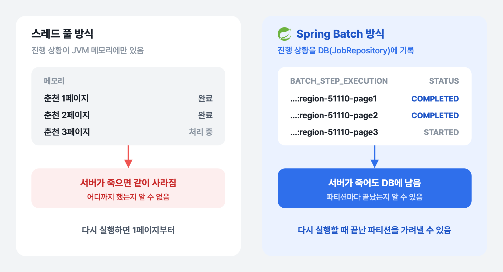
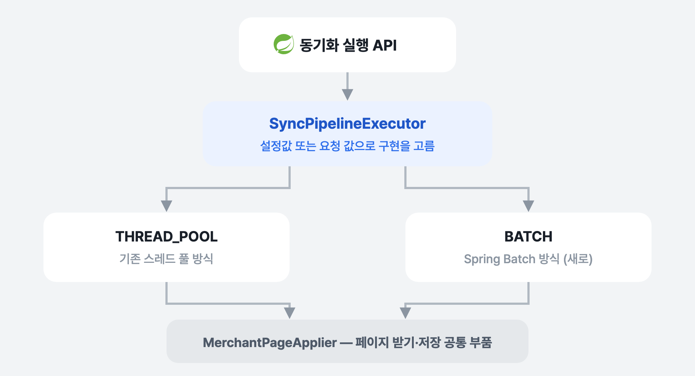

[1~3편](../gwpass-sync-parallel/)을 거치며 가맹점 동기화는 약 10분 만에 끝까지 돌게 됐습니다. 남은 문제는 **중간에 서버가 죽었을 때**였습니다. 이번 글은 동기화를 Spring Batch로 옮긴 이야기입니다.

## 문제: 어디까지 했는지 모른다

스레드 풀 방식은 진행 상황을 메모리에만 들고 있습니다. 어느 페이지까지 저장했는지가 프로세스 안에만 있어서, 동기화 도중 서버가 죽으면 그 정보도 같이 사라집니다. 다시 돌리면 처음부터입니다.

저장 자체는 고유 번호 기준 upsert라 처음부터 다시 돌려도 데이터가 틀어지지는 않습니다([2편](../gwpass-sync-conflict/)). 하지만 이미 끝낸 페이지를 다시 받느라 외부 API를 다시 부르고, 10분을 다시 기다려야 합니다. 서버가 다시 떠도, 새 프로세스는 동기화가 돌다 말았다는 것조차 모릅니다.

필요한 것은 두 가지였습니다.

- **진행 상태를 DB에 남기기** — 어느 페이지가 끝났는지 프로세스 밖에 기록
- **다시 시작할 때 끝난 것은 건너뛰기**

이걸 직접 만들 수도 있지만, Spring Batch가 바로 이 일을 하는 프레임워크라서 도입했습니다.

### Spring Batch란

Spring Batch는 대량 데이터를 정해진 순서로 처리하는 작업(배치)을 만드는 프레임워크입니다. 이 글에 필요한 개념만 짚으면 이렇습니다.

| 개념 | 뜻 | 이 프로젝트에서 |
|---|---|---|
| **Job** | 배치 작업 하나 | 동기화 전체 (`merchantSyncJob`) |
| **Step** | Job을 이루는 단계, 차례로 실행 | 관광지 → 가맹점 → 코스 생성 → 캐시 비우기 |
| **Tasklet Step** | 한 번 실행하고 끝나는 단계 | 관광지 동기화, 코스 생성처럼 기존 서비스를 한 번 부르는 단계 |
| **Chunk Step** | 읽기(Reader) → 가공(Processor) → 쓰기(Writer)를 반복하는 단계 | 가맹점 페이지 처리 |
| **Partitioner** | 한 Step의 일을 여러 조각(파티션)으로 나누고, 조각마다 워커 Step을 따로 실행 | (지역, 페이지)마다 파티션 하나 |
| **JobRepository** | Job·Step의 실행 기록을 DB 테이블에 남기는 저장소 | 어느 파티션이 끝났는지가 여기 남음 |
| **JobInstance / JobExecution** | 같은 파라미터로 실행한 Job 하나 / 그 Job을 실제로 돌린 한 번 | 실패한 Job을 재시작하면 같은 JobInstance에 JobExecution이 하나 더 생김 |

핵심은 **JobRepository**입니다. Step과 파티션마다 시작·완료·실패 상태가 DB에 남기 때문에, 서버가 죽어도 무엇이 끝났는지 알 수 있고 실패한 Job을 재시작하면 완료된 Step은 건너뜁니다.



*진행 상황이 어디에 남는가*

## 한 번에 갈아엎지 않기

스레드 풀 방식은 측정과 수정을 거쳐 이제 잘 돌고 있었습니다. 이걸 한 번에 Spring Batch로 바꾸면, 새 방식에 문제가 생겼을 때 돌아갈 곳이 없습니다. 그래서 **두 방식을 나란히 두고 설정으로 고르게** 만든 뒤 옮기기 시작했습니다.



*실행 방식을 인터페이스 뒤로 숨기고 설정으로 고른다*

먼저 동기화 파이프라인 전체를 `SyncPipelineExecutor` 인터페이스로 감쌌습니다. 동기화 실행 API는 이 인터페이스만 알고, 실제 구현은 설정값(`gwpass.sync-pipeline.default-strategy`)이나 요청 값으로 고릅니다. 페이지 하나를 받아 오고 저장하는 부분(`MerchantPageApplier`)은 따로 떼어 두 방식이 같이 쓰게 했습니다. 1~3편에서 고친 재시도·충돌 처리를 새 방식에서도 그대로 쓰기 위해서입니다.

그다음 Spring Batch 쪽을 한 단계씩 쌓았습니다. 단계마다 따로 커밋하고, 기존 스레드 풀 코드는 건드리지 않았습니다.

1. **뼈대**: Spring Batch를 추가하고, 아무 일도 안 하는 Job 하나로 실행 기록 테이블과 실행 경로가 동작하는지 통합 테스트로 확인했습니다. 실행 기록 테이블은 Spring Batch가 자동으로 만들게 두지 않고 Flyway 마이그레이션으로 관리했습니다. 이 프로젝트는 DB 스키마를 Flyway로만 바꾸기로 정해 두었기 때문입니다. 앱이 뜰 때 Job이 자동으로 실행되는 것도 껐습니다.
2. **Tasklet 단계**: 관광지 동기화, 코스 생성, 캐시 비우기를 기존 서비스를 한 번 부르는 Tasklet으로 감쌌습니다.
3. **가맹점 파티셔닝**: 가장 큰 가맹점 단계를 파티션으로 나눴습니다(아래).
4. **연결과 집계**: `BATCH` 전략을 `SyncPipelineExecutor` 구현체로 연결하고, Job이 끝나면 단계별 결과를 1편의 `sync_runs` 테이블에 기록하게 했습니다. 두 방식의 시간을 같은 표에서 비교하기 위해서입니다.
5. **크래시 복구**: 서버가 죽었다 뜨면 멈춘 Job을 이어서 실행하게 했습니다(5편).

마지막에 기본 전략을 `BATCH`로 바꿨습니다. 문제가 생기면 설정값 하나로 `THREAD_POOL`로 돌아갈 수 있습니다.

## Job 구성

![merchantSyncJob은 tourSyncStep, merchantPageSyncStep, courseGenerationStep, cacheEvictStep 네 Step을 차례로 실행한다. 이 중 가맹점 단계인 merchantPageSyncStep은 매니저 Step이다. Partitioner가 18개 시군의 1페이지를 먼저 받아 region-51110-page1처럼 (지역, 페이지)마다 ExecutionContext를 하나씩, 최대 243개 만들고, TaskExecutorPartitionHandler가 스레드 8개로 파티션마다 워커 Step을 실행한다. 워커 Step은 chunk(1)로 Reader, Processor, Writer를 거치고 faultTolerant 설정으로 retry 2, skip 3을 둔다. Job, Step, 파티션의 시작·완료·실패는 모두 JobRepository가 PostgreSQL의 BATCH_JOB_EXECUTION, BATCH_STEP_EXECUTION, BATCH_STEP_EXECUTION_CONTEXT 테이블에 기록한다](../../assets/posts/gwpass-sync-spring-batch/job.png)

*merchantSyncJob 구성*

가맹점 단계는 1편에서 확인한 **(지역, 페이지) 분할을 그대로** 파티셔닝으로 옮겼습니다.

- **Partitioner**가 18개 시군의 1페이지를 동시에 받아 시군별 페이지 수를 알아낸 뒤, (지역, 페이지)마다 파티션을 만듭니다. 최대 243개였습니다.
- 1페이지는 이미 받아 왔으니 **받은 데이터를 파티션 정보(ExecutionContext)에 담아** 넘겨서, 워커가 같은 페이지를 다시 부르지 않게 했습니다.
- 파티션은 스레드 8개짜리 `TaskExecutor`에서 실행됩니다. 1편에서 실측으로 정한 동시 처리 수 8을 그대로 씁니다.
- 워커 Step은 **chunk 크기 1**, 즉 페이지 하나가 아이템 하나입니다. 외부 API 실패(`ApiException`)는 Spring Batch의 `faultTolerant` 설정으로 처리합니다. 같은 아이템을 최대 2번까지 시도하고(`retryLimit(2)`), 그래도 실패하면 건너뜁니다(`skipLimit(3)`, 최대 3건).
- 각 파티션의 실행은 이름이 `merchantPageWorkerStep:region-51110-page1` 같은 워커 StepExecution으로 JobRepository에 따로 남습니다. 어느 파티션이 끝났는지를 이 기록으로 알 수 있습니다.

## 워커를 Reader / Processor / Writer로 나누기

처음 만든 워커는 Reader가 API 호출부터 저장까지 다 하고, Writer는 결과만 기록했습니다. 1편에서 잰 대로 시간의 97.8%가 API 대기이고 DB는 0.72%라서, 역할을 나눠도 빨라지는 건 없다고 봤기 때문입니다.

하지만 이름과 하는 일이 달라서 읽기 어려웠고, 나중에 역할에 맞게 다시 나눴습니다.

| 단계 | 하는 일 |
|---|---|
| Reader | API로 페이지를 받아 파싱 |
| Processor | 기존 가맹점 조회, 걸러 낼지·넣을지·고칠지 판단 |
| Writer | 판단대로 저장 |

나누고 나니 2편에서 풀었던 충돌 문제가 다른 모양으로 다시 보였습니다.

### 다시 시도할 때는 판단도 새로 해야 한다

Writer가 저장하다 충돌(UNIQUE 위반·데드락)이 나서 다시 시도할 때, Processor가 내려 둔 판단을 그대로 쓰면 같은 충돌이 반복됩니다. Processor가 "이 가맹점은 없으니 insert"라고 판단했는데 그 사이 다른 스레드가 같은 가맹점을 넣었다면, 몇 번을 다시 해도 insert는 실패합니다.


*다시 시도할 때 오래된 판단을 쓰면 같은 충돌이 반복된다*

그래서 Writer는 첫 시도에서는 Processor의 판단대로 저장하고, 충돌 뒤 다시 시도할 때는 **조회 → 판단 → 저장을 새 트랜잭션(`REQUIRES_NEW`) 안에서 통째로 다시** 합니다. 2편에서 "다시 시도할 때 조회부터 새로 한다"던 것을 역할을 나눈 구조에 맞게 옮긴 것입니다.

```java
if (attempt == 1) {
    // 첫 시도: Processor가 내린 판단대로 저장
    return transactionTemplate.execute(status -> { pageApplier.saveChanges(processing.changed()); ... });
}
// 다시 시도: 그 사이 바뀐 DB를 기준으로 조회·판단부터 새로
return transactionTemplate.execute(status -> {
    PageProcessingResult refreshed = pageApplier.processPage(item.page().data());
    pageApplier.saveChanges(refreshed.changed());
    ...
});
```

Writer 안에서 3번 다 실패하면 `ApiException`으로 바꿔 던집니다. 그러면 앞에서 말한 Step의 `faultTolerant` 설정이 받아서 다시 시도하거나 건너뜁니다. 저장 충돌은 Writer 안에서 먼저 풀고, 그래도 안 되는 것만 Spring Batch에 넘기는 두 겹 구조입니다.

새 트랜잭션으로 연 이유는 PostgreSQL에서는 트랜잭션 안에서 SQL 하나가 실패하면 롤백하기 전까지 그 트랜잭션을 더 쓸 수 없기 때문입니다. 시도할 때마다 바깥 chunk 트랜잭션과 떨어진 새 트랜잭션에서 깨끗하게 시작하게 했습니다.

1페이지도 Partitioner가 받아 둔 원본 데이터를 Reader가 꺼내 쓰게 해서, 다른 페이지와 똑같이 Reader → Processor → Writer를 지나게 맞췄습니다.

실제 서버에서 빈 DB와 데이터가 이미 있는 DB 두 상태로 전체 동기화를 돌려 봤고, 두 번 모두 저장 충돌이 실제로 났지만 다시 시도로 풀려 성공으로 끝났습니다.

## 남은 것
진행 상태를 DB에 남기게 됐다고 해서 **서버가 죽은 뒤 저절로 이어지지는 않았습니다.** 실제로 동기화 도중 서버를 강제로 죽여 보니, 다시 뜬 서버는 동기화를 아예 시작조차 못 했습니다. 5편에서 다룹니다.

## 정리

- 진행 상황이 메모리에만 있으면 **서버가 죽을 때 같이 사라집니다.** Spring Batch의 JobRepository로 파티션마다 상태를 DB에 남겼습니다.
- 잘 돌던 방식을 한 번에 바꾸지 않았습니다. **전략 인터페이스로 두 방식을 나란히 두고**, 단계별로 옮긴 뒤 설정값 하나로 전환했습니다.
- 조회·판단·저장을 나누면, **다시 시도할 때 판단도 새로 해야 합니다.** 오래된 판단으로 다시 저장하면 같은 충돌이 반복됩니다.
