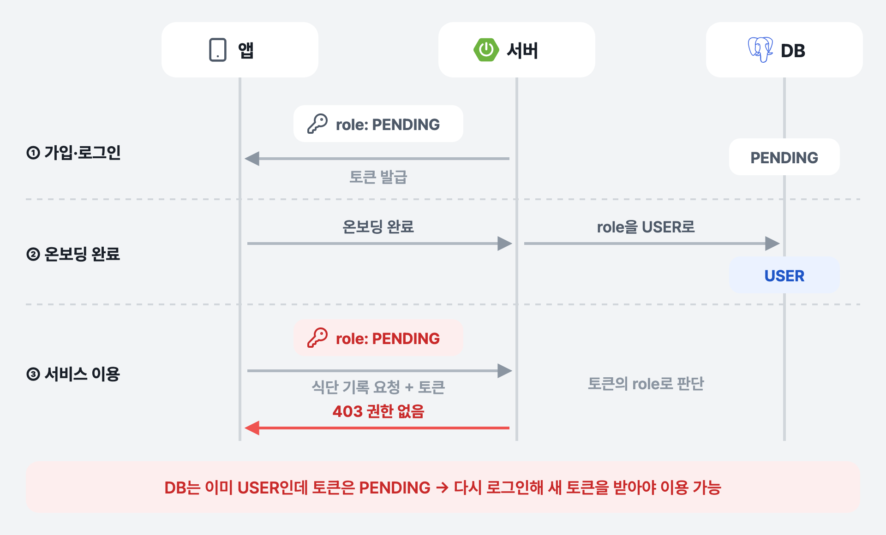
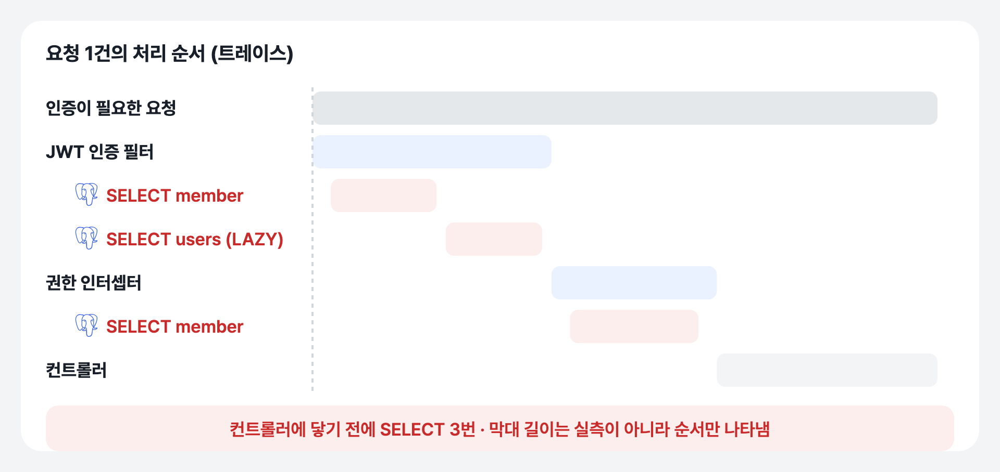
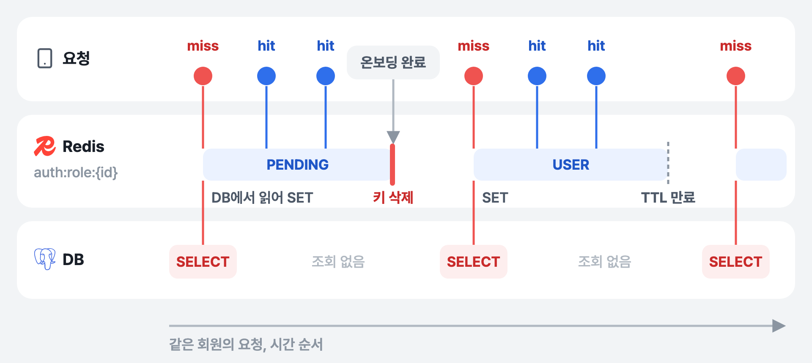
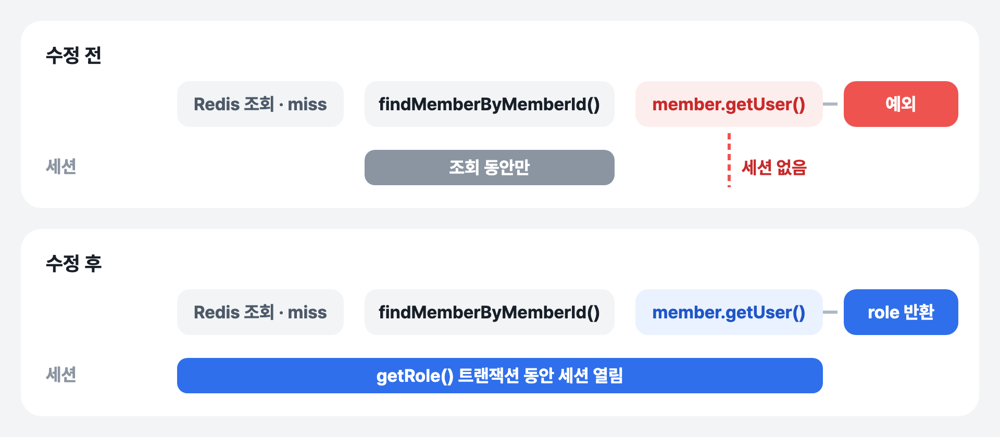
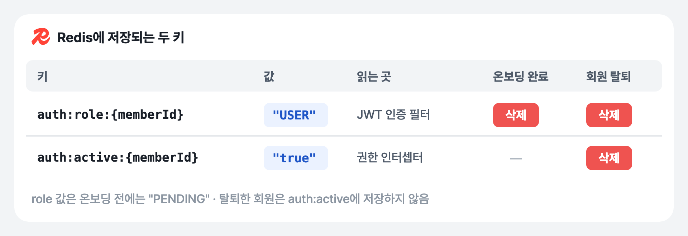
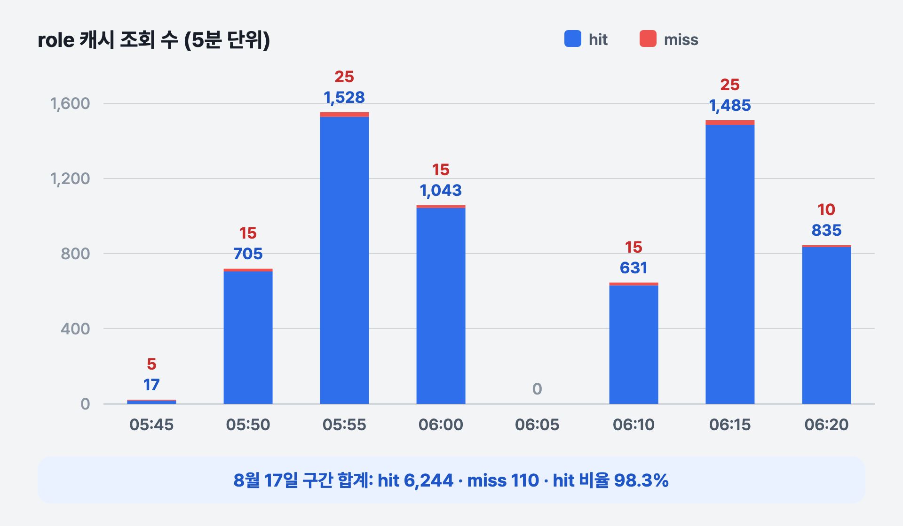

끼록은 끼니 기록으로 건강 관리를 돕는 앱입니다. 사용자가 식사를 기록하면 AI가 식습관을 분석해 리포트를 주고, 캐릭터 성장과 미션으로 기록을 이어 가게 합니다. 이 글은 끼록 서버의 인증 경로에 Redis 캐시를 붙인 이야기입니다. 캐시를 붙이게 된 계기, 붙이면서 생긴 문제, 그리고 효과를 확인하려고 넣은 계측을 다룹니다.

## 권한을 토큰에서 뺀 이유

끼록 API의 권한 검사는 커스텀 어노테이션으로 합니다. 컨트롤러나 메서드에 `@RoleUserAuth`, `@RoleAdminAuth` 같은 어노테이션을 붙이면, 인터셉터가 요청한 회원의 role을 보고 통과 여부를 정합니다. 처음에는 이 role을 **JWT access token의 claim**에 담아 두고, 요청이 오면 토큰에서 바로 꺼내 썼습니다.

문제는 가입한 회원의 role이 온보딩을 거치며 바뀐다는 점이었습니다. 가입하면 `PENDING`으로 시작하고, 온보딩을 마치면 `USER`가 됩니다. 식단 기록 같은 API는 `USER`만 쓸 수 있습니다.



*온보딩을 마쳐도 토큰의 role은 PENDING으로 남았다*

DB는 이미 `USER`인데 서버는 토큰에 남은 `PENDING`을 보고 막았습니다. **온보딩을 마친 사용자가 다시 로그인해야** 서비스를 쓸 수 있었습니다.

그래서 토큰에서 role claim을 빼고 회원 ID만 남겼습니다. JWT 인증 필터는 요청마다 이 회원 ID로 **DB에서 role을 조회**합니다. 이제 온보딩이 끝나면 다음 요청부터 바뀐 role이 적용됩니다.

## 대신 요청마다 DB를 세 번 조회하게 됐다

토큰에서 role을 빼자, 인증이 필요한 요청마다 DB를 조회하게 됐습니다. 원래 있던 조회까지 세면 이렇습니다.



*인증이 필요한 요청 하나가 컨트롤러에 닿기 전에 하는 조회 (막대 길이는 순서만 나타냄)*

- **JWT 인증 필터(role 조회)**: `member`를 조회하고, role은 연관된 `users` 엔티티에 있어서 지연 로딩(LAZY)으로 한 번 더 조회합니다.
- **권한 인터셉터(활성 회원 체크)**: `@RoleUserAuth`가 붙은 API는 탈퇴한 회원을 막으려고 `member`를 다시 조회합니다. 이 조회는 role claim을 빼기 전부터 요청마다 하고 있었습니다.

필터와 인터셉터는 서로 다른 트랜잭션에서 돌기 때문에 같은 `member`라도 따로 조회됩니다. 비즈니스 로직이 시작되기도 전에 SELECT가 세 번 나가는 셈입니다.

## Redis cache-aside 붙이기

이 조회를 줄이려고 role과 활성 회원 여부를 캐시에 두기로 했습니다. 끼록은 refresh token과 이메일 인증 코드를 저장하려고 이미 Redis를 쓰고 있었습니다. 캐시도 따로 고민할 것 없이 Redis에 두었습니다. role은 문자열 하나라 메모리를 거의 차지하지 않고, Spring Data Redis로 바로 쓸 수 있고, 키마다 TTL을 걸어 만료를 맡길 수 있습니다.

방식은 **cache-aside**입니다. 먼저 캐시를 보고, 없으면 DB에서 읽어 캐시에 넣어 두는 방식입니다. 키는 `auth:role:{memberId}`입니다.



*같은 회원의 요청이 이어질 때 role 캐시의 모습 (요청 간격은 예시)*

신경 쓴 것은 **캐시가 인증을 막는 일이 없게** 하는 것이었습니다. 인증은 모든 요청이 지나가는 길이라, Redis 문제로 요청이 실패하면 서비스 전체가 멈춥니다.

- **Redis 읽기가 실패하면** miss로 보고 DB에서 읽습니다.
- **Redis 쓰기가 실패하면** 무시합니다. 다음 요청이 다시 miss가 되어 그때 다시 넣습니다.
- **온보딩이 끝나면** 그 회원의 키를 지웁니다. 다음 요청은 DB에서 새 role(`USER`)을 읽어 옵니다.
- **키 삭제가 실패하면** 로그만 남기고 온보딩 트랜잭션은 그대로 진행합니다. 지우지 못한 옛 role은 TTL이 지나면 사라지고, 그 뒤에는 DB 값으로 다시 채워집니다.

## 캐시 miss에서만 인증이 깨졌다

캐시를 붙인 뒤 로그에서 `LazyInitializationException`이 보였습니다. 늘 나는 것이 아니라 **캐시 miss일 때만** 났습니다. 가입하고 처음 보내는 요청이나 TTL이 지난 뒤의 요청처럼, Redis에 값이 없어 DB까지 내려가는 경우였습니다.

원인은 트랜잭션 경계였습니다. 끼록은 `spring.jpa.open-in-view`를 `false`로 두어 영속성 컨텍스트(세션)가 트랜잭션이 끝나면 함께 닫힙니다. 회원 조회 메서드(`findMemberByMemberId()`)는 자기 트랜잭션 안에서 `member`만 읽고 끝납니다. 그 뒤 role을 꺼내려고 `member.getUser()`에 접근하면 `users`를 지연 로딩해야 하는데, 이미 세션이 닫혀 있어 예외가 납니다. JWT 인증 필터는 자체 트랜잭션이 없어서 이 상황이 그대로 드러났고, 필터가 예외를 잡아 500으로 응답했습니다.



*세션이 열려 있는 구간과 getUser() 호출 시점*

`getRole()` 전체에 `@Transactional(readOnly = true)`를 붙여, role을 꺼내는 지점까지 세션이 열려 있게 했습니다. 캐시 hit일 때는 DB에 가지 않으니 이 코드를 지나가지 않고, miss일 때만 지나가는 길이라 hit에서는 드러나지 않았습니다.

## 활성 회원 체크도 캐시로, 그리고 분리

role 조회를 캐시로 줄이고 나니, 남은 조회는 권한 인터셉터의 활성 회원 체크였습니다. 처음에는 **role 캐시를 그대로 재사용**했습니다. role 캐시에 값이 있으면 이미 한 번 DB에서 탈퇴하지 않은 회원으로 확인된 것이니, 활성 체크도 통과시키는 방식입니다. 대신 회원이 탈퇴하면 role 캐시를 바로 지우게 했습니다.

하지만 기획상 권한과 탈퇴 여부는 따로 다루는 정보였고, 두 정보를 지워야 하는 시점도 달라질 수 있었습니다. 그래서 활성 회원 체크 **전용 캐시**를 따로 두었습니다.



*두 키의 값과 각각을 지우는 때*

- **활성 회원 캐시**(`auth:active:{memberId}`)에는 "활성"이라는 사실만 저장합니다. 탈퇴한 회원은 **저장하지 않습니다.** 탈퇴한 회원의 요청은 늘 DB까지 가서 막힙니다.
- **탈퇴할 때는** 두 캐시를 모두 지우고, **온보딩이 끝날 때는** 권한 캐시만 지웁니다.

캐시가 두 개가 되면서 Redis를 다루는 코드도 정리했습니다. 도메인 지식이 없는 범용 `CacheRepository`(get·set·delete)를 두고, Redis 접근과 예외 변환만 여기서 맡게 했습니다. 키 이름, TTL, 값 변환은 각 캐시 서비스가 그대로 갖습니다. 다른 도메인에 캐시가 생겨도 이 층을 다시 쓸 수 있습니다.

## 캐시가 잘 맞는지 보기: 계측

캐시를 붙였으면 실제로 얼마나 맞는지 알아야 합니다. hit 비율이 낮다면 Redis를 한 번 더 거치는 비용만 늘린 셈이기 때문입니다.

### Micrometer란

**Micrometer**는 애플리케이션 지표를 모으는 라이브러리입니다. 코드는 `MeterRegistry`에 카운터·타이머 같은 지표를 기록하기만 하고, 그 지표를 어디로 보낼지(로그, Prometheus, Datadog 등)는 등록한 registry가 정합니다. 그래서 나중에 모니터링 도구를 바꿔도 계측 코드는 그대로 둘 수 있습니다. Spring Boot Actuator를 넣으면 JVM, 커넥션 풀, HTTP 요청 같은 지표도 Micrometer로 자동 계측됩니다.

끼록에서는 두 캐시 서비스가 조회할 때마다 `cache.lookup` 카운터를 올립니다. 태그로 어떤 캐시인지(`cache`)와 결과(`result=hit|miss`)를 구분합니다.

```java
if (cached.isPresent()) {
    meterRegistry.counter("cache.lookup",
            "cache", "role_cache", "result", "hit").increment();
    return cached.get();
}
meterRegistry.counter("cache.lookup",
        "cache", "role_cache", "result", "miss").increment();
```

### 지표는 로그로

끼록에는 지표를 모아 보는 도구를 따로 붙이지 않았습니다. 그래서 registry로는 **LoggingMeterRegistry**만 등록했습니다. 5분마다 집계한 값을 로그 한 줄로 남기는 registry입니다. 서버 로그는 1시간마다 압축되어 Cloudflare R2에 올라가 보관되므로, 지표도 함께 남습니다.


*허용한 지표만 로그를 거쳐 R2 파일에 남는다*

Actuator를 넣고 나니 문제가 하나 생겼습니다. Actuator가 자동 계측하는 수십 개의 지표가 집계 주기마다 **전부 로그로 찍혔습니다.** 보고 싶은 캐시 줄이 그 사이에 묻혔습니다. 그래서 registry에 `MeterFilter.denyUnless`를 걸어, 허용 목록에 있는 이름의 지표만 남기게 했습니다. 허용 목록은 `MetricFilters` enum으로 관리해 지표마다 켜고 끌 수 있게 했습니다.

여기에 `cache.lookup` 말고 두 지표를 더 켰습니다. Spring Data repository 메서드 호출(`spring.data.repository.invocations`)과 HTTP 요청 응답 시간(`http.server.requests`)입니다. 어떤 조회가 자주, 오래 불리는지 보고 **다음 캐싱 후보를 데이터로 고르기** 위해서입니다.

## 결과

계측을 배포한 뒤 R2에 쌓인 서버 로그를 모두 받아 `cache.lookup` 줄을 모았습니다. 8월 15일부터 9월 9일까지 시간별 로그 파일 619개입니다.

LoggingMeterRegistry는 카운터를 5분 동안의 **초당 처리량(throughput)** 으로 남깁니다. 그래서 여기에 300초를 곱해 횟수로 바꿨습니다.


*R2 로그에서 값을 그대로 가져와 다시 짠 화면 (로그 레벨·스레드 등 앞부분은 생략)*

이 로그는 develop 브랜치가 배포되는 dev 서버의 것이라 요청이 많지 않았습니다. 캐시 조회가 찍힌 구간은 8월 17일의 약 35분과 8월 19일의 5분 구간 두 개뿐이고, 나머지 시간에는 토큰을 단 요청이 없었습니다. 그래서 아래 수치는 대부분 8월 17일 구간에서 나왔습니다.



*8월 17일 구간의 role 캐시 hit/miss (로그 시각 기준)*

| | hit | miss | hit 비율 |
|---|---|---|---|
| role 캐시 (8월 17일 구간) | 6,244 | 110 | 98.3% |
| 활성 회원 캐시 (8월 17일 구간) | 6,244 | 110 | 98.3% |
| role 캐시 (전체) | 6,271 | 112 | 98.2% |
| 활성 회원 캐시 (전체) | 6,267 | 113 | 98.2% |

조회 수가 가장 많았던 05:55 구간을 보면, 두 캐시 모두 1,553번 조회돼 1,528번이 hit였습니다. 같은 5분 동안 `MemberRepository.findById`는 340번 불렸습니다. role hit 한 번은 SELECT 두 번(member, users)을, 활성 회원 hit 한 번은 SELECT 한 번(member)을 건너뜁니다. 계산하면 이 5분 동안 1,528 × 3 = **4,584번의 SELECT가 나가지 않았습니다.** 8월 17일 구간 전체로는 6,244 × 3 = 18,732번입니다.

다만 캐시를 붙이기 전과 비교한 수치는 없습니다. 계측은 캐시를 붙인 뒤에 들어가서 캐시가 없던 시기의 로그에는 이 지표가 없고, 응답 시간도 캐시 유무로 나눠 비교하지 않았습니다. 위의 SELECT 수는 캐시 구조에서 계산한 값입니다. 또 짧은 시간에 요청이 몰린 구간이라, 같은 회원의 요청이 이어지면 hit 비율은 높게 나오기 쉽습니다. 98%대라는 숫자를 평소 트래픽의 hit 비율로 보기는 어렵고, 요청이 쌓이면 다시 확인해야 합니다.

## 앞으로 할 일

**계측으로 다음 캐싱 후보를 고릅니다.** repository 호출과 HTTP 응답 시간 지표를 켜 둔 것은 이 단계를 위해서입니다.

## 정리

- 온보딩 뒤 재로그인 없이 권한이 바뀌게 하려고 **JWT에서 role을 빼자**, 인증이 필요한 요청마다 DB를 세 번 조회하게 됐습니다.
- 권한과 활성 회원 조회에 **Redis cache-aside**를 붙였습니다. Redis 오류는 DB로 흘려보내 인증을 막지 않게 했고, role이 바뀌거나 회원이 탈퇴하면 키를 지웁니다.
- 캐시 miss에서만 지나가는 길에 **트랜잭션 경계 버그**가 숨어 있었습니다. 지연 로딩이 끝날 때까지 트랜잭션을 이어 고쳤습니다.
- 지표를 모아 보는 도구 대신 **Micrometer + LoggingMeterRegistry**로 hit/miss를 로그에 남기고, 그 로그를 R2에 보관합니다.
- R2 로그로 본 hit 비율은 98%대였습니다. 다만 짧은 구간에 몰린 요청에서 나온 값이라, 평소 트래픽에서는 다시 확인이 필요합니다.
