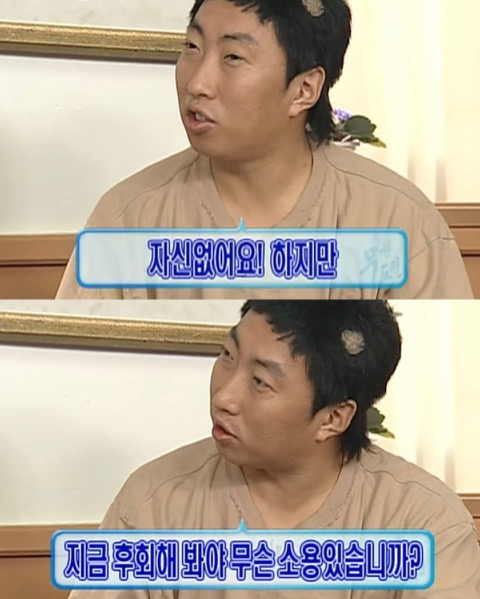

공부하거나 프로젝트를 하면서 정리한 내용이 그동안 여기저기 흩어져 있었습니다. 적어 둔 곳도 제각각이고 쓸 때마다 형식도 달라서 나중에 다시 찾아보기가 어려웠습니다. 노션에도 정리해 봤지만 적어 두고 나면 다시 열어 보는 일이 잘 없었습니다.

그래서 한곳에 같은 형식으로 모아 두려고 블로그를 직접 만들었습니다.

지난 프로젝트와 지금 하고 있는 프로젝트, 앞으로 할 프로젝트에서 내린 결정과 겪은 문제를 주로 쓰려고 합니다. 공부한 내용이나 프로젝트를 마친 뒤의 회고도 가끔 올릴 생각입니다.

그럼 이제 시작합니다..!

*출처: MBC 〈무한도전〉*
