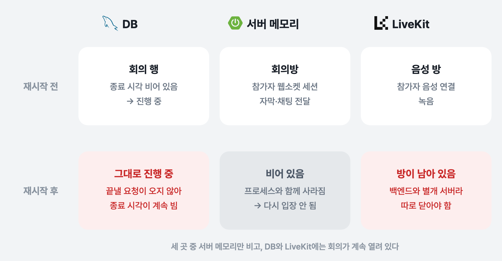
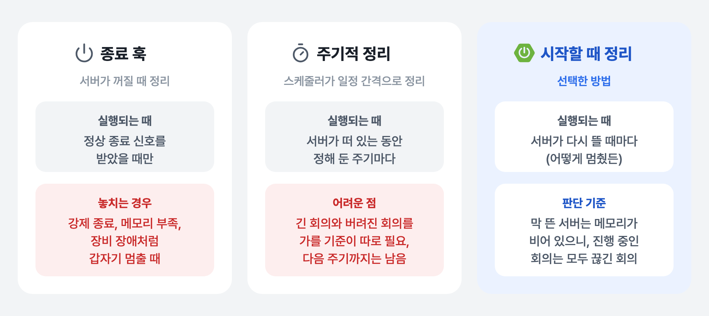

[3편](../whylog-transcript-interim/) 끝에서 발화 목록이 서버 메모리에만 있어서 회의 도중 서버가 재시작되면 사라진다고 적었습니다. 메모리에만 있던 건 발화 목록만이 아니었습니다. 지금 누가 회의방에 들어와 있는지도 메모리에 있었습니다. 이번 글은 회의 도중 서버가 멈췄다가 다시 뜨면 그 회의가 끝나지 않고 계속 **"진행 중"으로 남던 문제**를 다룹니다.

## 회의 상태는 세 곳에 나뉘어 있었다

WhyLog의 실시간 회의 하나는 세 곳에 상태를 남깁니다.

| 위치 | 담는 것 | 서버 재시작 뒤 |
|---|---|---|
| **DB** | 회의 행. 시작 시각, 종료 시각 | 남음 |
| **서버 메모리** | 회의방. 접속한 참가자의 웹소켓 세션 (`ConcurrentHashMap`) | 사라짐 |
| **LiveKit** | 음성 방. 참가자 음성 연결과 녹음 | 남음 (별도 서버) |

회의가 진행 중인지는 DB의 **종료 시각**으로 판단합니다. 종료 시각이 비어 있으면 `ONGOING`, 채워져 있으면 `COMPLETED`입니다. 회의 목록 API도 이 값으로 "진행 중"과 "진행 완료"를 나눠서 보여 줍니다.

```java
public MeetingStatus getStatus() {
    return this.endDateTime == null ? MeetingStatus.ONGOING : MeetingStatus.COMPLETED;
}
```

종료 시각을 채우는 길은 두 가지였습니다. 사용자가 **회의 종료 API**를 부르거나, 웹소켓 연결이 끊길 때 방에 남은 사람이 없으면 **자동으로 종료**하는 것입니다. 둘 다 **서버가 살아 있을 때** 들어오는 요청이나 이벤트가 계기라는 공통점이 있습니다.

## 문제: 들어갈 수 없는 "진행 중" 회의

회의 도중 서버가 멈추거나 재배포로 재시작되면 이렇게 됐습니다.



*재시작 전후 회의 상태 — 메모리만 비고, 나머지 두 곳에는 회의가 계속 열려 있다*

- 회의 목록에는 그 회의가 계속 **"진행 중"** 으로 떠 있었습니다.
- 그런데 눌러서 다시 들어가려고 하면 **입장이 되지 않았습니다.** 재시작으로 서버 메모리에 있던 회의방 정보가 사라졌기 때문입니다.
- DB를 확인해 보니 그 회의의 **종료 시각이 비어 있었습니다.** 서버는 이 회의를 여전히 진행 중이라고 판단하고 있었습니다.
- **LiveKit 방**도 닫히지 않았습니다. LiveKit은 백엔드와 따로 떠 있는 서버라 백엔드가 재시작돼도 방이 그대로 남습니다.

종료 API를 부를 사람도, 자동 종료를 일으킬 웹소켓 연결도 이미 사라졌기 때문에, 이 회의를 끝내 줄 계기가 없었습니다. 접속은 안 되는데 끝나지도 않는 회의가 목록에 계속 쌓였습니다.

같은 회의를 두고 세 곳이 서로 다른 말을 하는, **메모리와 DB 사이의 상태 정합성**이 깨진 상황입니다. DB만 놓고 보면 깨진 데이터는 없습니다. 종료 시각이 비어 있는 것도 진행 중인 회의라면 맞는 값입니다. 문제는 그 값이 실제 상황(메모리에 회의방이 없음)과 맞지 않는다는 점이었고, 메모리와 LiveKit은 DB 트랜잭션 밖에 있어서 트랜잭션으로는 막을 수 없었습니다. 이렇게 끝내 줄 주체가 사라진 채 남은 상태를 **고아 상태(orphaned state)** 라고도 부릅니다.

## 언제 정리할까: 세 가지 방법

끊긴 회의를 누가, 언제 닫을지 세 가지 방법을 비교했습니다.



*끊긴 회의를 정리하는 세 가지 방법*

**종료 훅.** 서버가 꺼질 때(`@PreDestroy`, graceful shutdown) 진행 중인 회의를 닫는 방법입니다. 하지만 종료 훅은 서버가 **정상 종료 신호를 받고 스스로 내려갈 때만** 실행됩니다. 프로세스가 강제로 죽거나, 메모리가 부족해 운영체제가 종료시키거나, 장비에 장애가 나서 갑자기 멈추면 훅이 돌 기회 자체가 없습니다. 이번 문제는 바로 이렇게 예고 없이 멈추는 경우에도 생기기 때문에 종료 훅만으로는 막을 수 없었습니다.

**주기적 정리.** 스케줄러가 일정 간격으로 오래된 진행 중 회의를 찾아 닫는 방법입니다. 이 방법은 **"버려진 회의"를 가려낼 기준**이 따로 있어야 합니다. DB에는 시작 시각과 종료 시각만 있어서, 세 시간째 정말 진행 중인 회의와 서버가 죽어서 버려진 회의를 구분할 수 없습니다. 구분하려면 참가자 활동 시각을 계속 기록하는 장치를 새로 만들어야 합니다. 또 주기 사이에는 끊긴 회의가 목록에 그대로 남습니다.

**시작할 때 정리.** 서버가 다시 뜰 때 진행 중인 회의를 모두 닫는 방법입니다. 서버는 어떻게 멈췄든 결국 다시 시작되므로 이 시점은 놓칠 일이 없습니다. 판단 기준도 분명합니다. 회의방 정보는 서버 메모리에만 있으니 **막 뜬 서버에는 회의방이 하나도 없고**, 그 시점에 DB에서 진행 중인 회의는 전부 이전 프로세스에서 끊긴 회의입니다. 회의방 상태를 이미 서버 한 대의 메모리에 두는 구조였기 때문에 이 판단이 성립합니다.

그래서 **시작할 때 정리하는 방법**을 골랐습니다. "막 뜬 서버의 메모리는 비어 있다"는 사실을 기준으로 삼아 DB 상태를 거기에 다시 맞추는 것으로, 어긋난 상태를 기준 쪽에 맞춰 되돌리는 이런 작업을 **상태 재조정(reconciliation)** 이라고 합니다.

## 해결 1: 서버가 뜰 때 진행 중인 회의를 한 번에 종료

Spring Boot의 `ApplicationRunner`를 썼습니다. `ApplicationRunner`는 애플리케이션 컨텍스트가 다 준비된 뒤 **서버가 시작될 때 한 번** 실행되는 인터페이스입니다. 빈 주입과 트랜잭션을 그대로 쓸 수 있어서 시작 시점의 DB 정리 작업을 넣기에 알맞습니다.

```java
@Component
@RequiredArgsConstructor
public class MeetingStartupRecoveryService implements ApplicationRunner {

    private final MeetingRepository meetingRepository;

    @Override
    @Transactional
    public void run(ApplicationArguments args) {
        LocalDateTime recoveryTime = LocalDateTime.now();
        int updatedCount = meetingRepository.markAllOngoingMeetingsAsEnded(recoveryTime);

        if (updatedCount > 0) {
            log.warn("Recovered ongoing meetings on startup: count={}, endedAt={}", updatedCount, recoveryTime);
        }
    }
}
```

종료 시각이 비어 있는 회의를 하나씩 불러와 고치지 않고, **UPDATE 쿼리 한 번**으로 처리했습니다.

```java
@Modifying
@Query("""
    UPDATE Meeting m
    SET m.endDateTime = :endedAt
    WHERE m.endDateTime IS NULL
""")
int markAllOngoingMeetingsAsEnded(@Param("endedAt") LocalDateTime endedAt);
```

정리한 회의 수는 경고 로그로 남겼습니다. 로그에 이 줄이 찍혔다면 직전에 회의 도중 서버가 멈춘 적이 있다는 뜻입니다.

## 해결 2: 정상 종료와 비정상 종료를 구분

종료 시각만 채우면 재시작으로 끊긴 회의와 사용자가 직접 끝낸 회의를 구분할 수 없습니다. 끊긴 회의는 회의가 끝날 때 실행되는 녹음 중지와 분석을 거치지 않았고, 분석에 쓰는 발화 목록도 재시작과 함께 사라졌습니다. 그래서 회의에 **정상 종료 여부**(`isNormallyEnded`)를 함께 저장하도록 했습니다.

```java
@Column(name = "is_normally_ended", nullable = false)
private Boolean isNormallyEnded;   // 회의를 만들 때 false

public LocalDateTime endMeeting() {
    this.endDateTime = LocalDateTime.now();
    this.isNormallyEnded = true;    // 종료 API·자동 종료로 끝날 때만 true
    return this.endDateTime;
}
```

회의를 만들 때는 `false`이고, 종료 API나 자동 종료로 끝날 때만 `true`가 됩니다. 시작 시 정리 쿼리는 종료 시각만 채우고 이 값은 건드리지 않으므로, 재시작으로 닫힌 회의는 `false`로 남습니다.

비정상 종료된 회의는 **분석 파이프라인을 타지 않도록** 했습니다. 녹음 중지와 AI 분석 요청은 정상 종료 흐름에만 들어 있고, 시작 시 정리는 종료 시각만 채웁니다. 발화 목록이 사라진 회의를 분석하면 불완전한 회의 기록이 정상 기록처럼 남게 됩니다.

## 해결 3: LiveKit 방 정리

백엔드가 재시작돼도 LiveKit 방은 그대로 남기 때문에 이쪽도 닫아야 했습니다. 같은 작업에서 관리자용 API를 만들었습니다. LiveKit의 서버 API(`RoomService`)를 호출해서 열린 방 목록과 방별 참가자를 조회하고, 방을 삭제하거나 특정 참가자를 내보낼 수 있습니다. 방을 삭제하면 그 방에 연결된 참가자도 모두 끊깁니다.

## 남은 것

- **종료 시각이 실제로 끊긴 시각이 아닙니다.** 재시작한 시각이 종료 시각으로 들어가서, 서버가 오래 멈춰 있었다면 회의 시간이 그만큼 길게 계산됩니다. 마지막 발화 시각처럼 실제 활동이 끝난 시각을 따로 남겨 두면 더 정확해집니다.
- **구분 값을 아직 활용하지 못하고 있습니다.** 비정상 종료된 회의도 지금은 "진행 완료" 목록에 함께 보입니다. 목록에서 이 값으로 거르려면, 회의를 만들 때 `false`로 시작하는 진행 중 회의까지 같이 걸러지지 않도록 "종료 시각이 있고 정상 종료가 아닌 회의"만 골라내는 조건이 필요합니다.
- **LiveKit 방과 녹음은 자동으로 정리되지 않습니다.** 시작 시 정리는 DB만 다룹니다. 남은 LiveKit 방 정리와 녹음 중지까지 시작 시 정리에 넣으면 사람이 손댈 일이 없어집니다.
- **서버가 한 대일 때만 맞는 방법입니다.** 서버를 여러 대로 늘리면, 한 대가 재시작하면서 다른 서버에서 정상적으로 진행 중인 회의까지 종료해 버립니다. 그때는 회의방 상태를 Redis 같은 외부 저장소로 옮기거나, 회의마다 어느 서버가 맡고 있는지 기록해서 자기 회의만 정리하도록 바꿔야 합니다.

## 정리

- 상태가 **메모리와 DB에 나뉘어 있으면**, 프로세스가 죽는 순간 메모리 쪽만 사라지고 둘 사이의 **정합성이 깨집니다.** 트랜잭션은 DB 안만 지켜 주기 때문에, 어긋난 상태를 다시 맞추는 재조정 코드가 "정상 흐름" 밖에 따로 있어야 합니다.
- 정리 시점은 **놓치지 않는 시점**으로 고르는 게 중요했습니다. 종료 훅은 갑작스러운 중단을 놓치고, 주기적 정리는 판단 기준이 필요했습니다. 서버 시작은 어떻게 멈췄든 반드시 오고, 메모리가 비어 있다는 사실이 판단 기준이 돼 줬습니다.
- 강제로 닫은 데이터는 **정상 데이터와 구분할 표시**를 남겨 두어야 나중에 다르게 다룰 수 있습니다.
