WhyLog는 학교 캡스톤디자인으로 만든 프로젝트다. 사실상 졸업작품이라 이걸 끝내야 졸업을 할 수 있다. 기술 이야기는 [실시간 음성 회의 구현기](../whylog-voice-sfu/) 시리즈에 따로 정리했고 여기에는 팀을 꾸리고 기획하고 전시까지 간 이야기를 적어 보려고 한다.

## 출발 대행진

처음에는 팀을 어떻게 꾸리지 고민했는데, 고민했던 거보다 빠르게 팀원을 모았다. ( 진짜 걱정 괜히 함 )

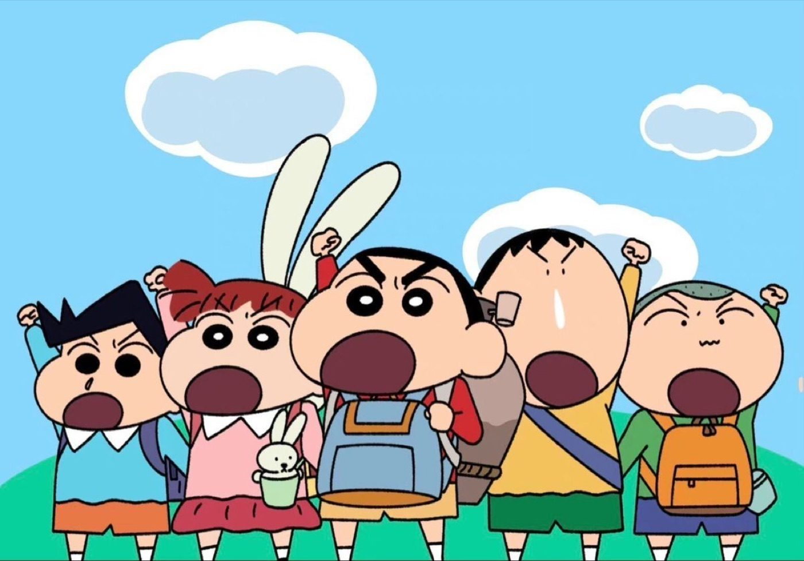
*떡잎방법대 출격 (출처: 〈짱구는 못말려〉)*

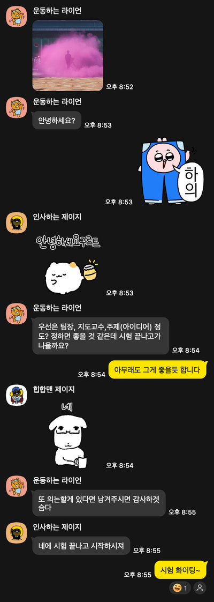
*무려 단톡방 파고 첫 대화*

### 기획 겸 팀장을 맡게 된…

사실 처음에는 할 생각이 없었다. 그런데 이전에 개발자들끼리 했던 프로젝트에서 기획을 주로 맡는 사람이 없다 보니, 팀원마다 이해한 내용이 달랐고 방향도 빠르고 명확하게 정해지지 못했다. 그래서 이번에는 기획을 맡을 사람을 한 명 정하기로 했다.

기획은 해 본 적이 없었지만 그동안 해 온 프로젝트 경험을 바탕으로 한번 해 보고 싶었다. 솔직히 기획은 내가 약한 분야라고 생각했고 이번 기회에 내 단점을 제대로 파악하고 고쳐 나가고 싶어서 내가 하겠다고 했다. 그래도 개인적으로는 조금 두려운 시작이었다.

## 기획 - 이제는 더 이상 물러날 곳이 없다

### 주제 선정

어떤 문제를 풀어 볼까 고민하다가, 기획은 처음이니까 일단 내가 직접 겪는 불편함부터 해결해 보기로 했다. 내가 맨날 하던 게 개발-회의-개발-회의의 반복이고, 요즘 AI도 많이 발달했으니 이쪽으로 해 보자는 생각이 들었다.

생각해 보니 맨날 회의는 하는데 회의록을 다시 들여다보지는 않았다. 왜일까 생각해 보니, 회의할 때 내용을 적긴 해도 회의마다 적는 내용도 다르고 요점도 매번 달라서 어떤 상황에 회의록을 찾아봐야겠다는 생각이 잘 들지 않았다. 우리가 논의한 내용이 실제로 어디까지 진행됐는지도 회의록만으로는 정확하게 알기 어려웠고 회의끼리의 앞뒤 관계나 회의 내용과 코드 사이의 관계도 한눈에 보이지 않았다.

그래서 회의록을 쉽게 정리하고 그 문서가 나중에 좀 더 영양가 있게 쓰이도록 하고 싶었다. AI로 회의를 요약하고 회의와 코드 사이의 관계를 분석해서 회의록만 보고도 진행 현황, 구현 현황, 앞으로 할 일 같은 걸 종합적으로 파악할 수 있게 하는 게 목표였다.

### 정리

뭘 만들지는 대충 정했는데, 이걸 어떻게 정리해서 팀원들에게 보여 줘야 할지에서 막혔다. 흐름이 좀 복잡할 수 있겠다 싶어서 개념과 흐름을 간단하게 정리해 공유하고 설명했다. 그리고 이걸 와이어프레임으로 만들어 흐름을 화면으로 그렸다.

아쉽게도 내가 봐도 쉽게 이해하기 어렵고 적어 둔 내용에 빈 곳이 있다는 게 보였다. 그래서 이런 부분을 최대한 꼼꼼히 챙기려고 했던 것 같다. 그래도 부족했던 걸 알기에 팀원들의 질문을 받을 각오를 하긴 했다.

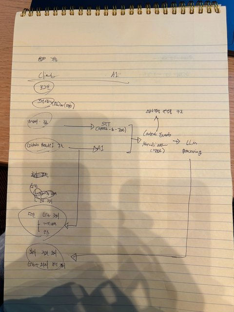
*전체 구조 스케치*

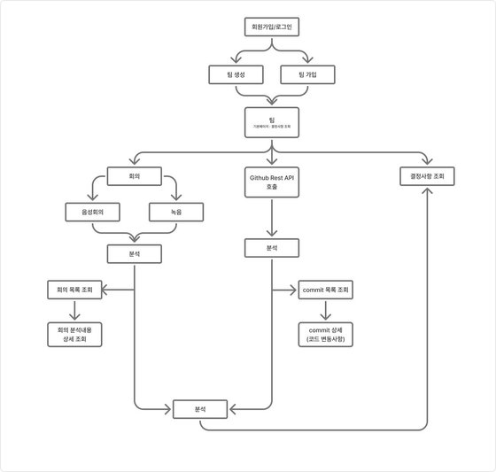
*스케치 후 피그잼으로 재구성*

### 피그마

생각해 보니 피그마를 제대로 다루어 본 적이 없었다. 그러다 보니 작업 속도가 굉장히 더뎠고 결과물도 내 뜻대로 나오지 않았다. 이건 딱히 해결한 방법이 있다기보다 최대한 익숙해지려고 노력했던 것 같다. 막히면 검색하거나 GPT의 도움을 받으면서 열심히 했다. 이때 MCP를 쓰지 않은 것도 피그마 자체에 익숙해지기 위해서였다.

그래도 어찌저찌 와이어프레임을 만들었다. 다시 생각해 보니 그때 부딪혀 봐서 이제야 좀 만질 줄 아는 것 같다.

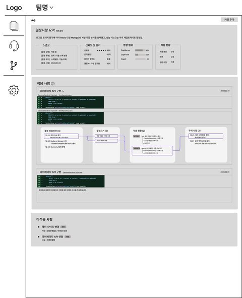
*매우 정직한 와이어프레임*

### 구현 가능성 체크

아무래도 개발자다 보니 구현이 가능한지부터 따져 봤다. GitHub API로 코드 내역을 가져오고, 음성 회의는 WebRTC로 만들고, 회의와 코드의 유사도는 벡터 검색으로 보면 되겠다는 정도의 생각이었다. 깊게 검증하진 않았지만 안 되지는 않을 것 같았다.

## 킥오프

킥오프는 내가 기획한 내용을 공유하는 식으로 진행했다. 다행히 다들 이해한 눈치였다. 기획을 공개한 뒤에는 전시회까지 구현할 범위와 앞으로 어떻게 진행할지 전반적인 프로세스를 같이 계획했다.

## 지도교수님과의 미팅

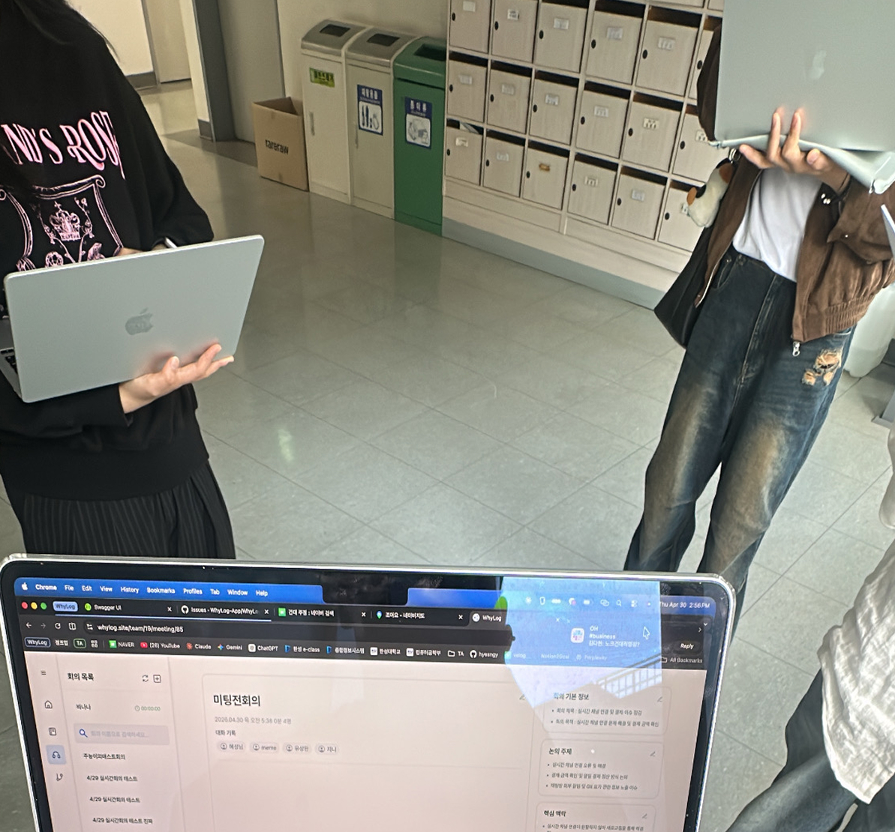
*미팅 전 연구실 앞 대기*

전시 전까지 지도교수님과 다섯 번 미팅을 했다. 미팅마다 기능을 하나씩 더 붙여서 보여 드렸는데, 피드백은 거의 매번 같은 곳을 향했다. 이 서비스를 왜 써야 하는가.

| 미팅 | 보여 드린 것 | 받은 피드백 |
| --- | --- | --- |
| 첫 번째 | 기획과 계획 | 구현 가능한가? 이게 뭘 위한 기획인지 명확하게 전달할 것 |
| 두 번째 | 실시간 회의 | 아직 서비스를 써야 할 이유가 약하다 |
| 세 번째 | GitHub 연결 | 좀 나아졌지만 필요한 이유를 더 명확히 할 것 |
| 네 번째 | 코드•회의 분석 | 필요성은 인정. 이제 3분 안에 발표할 수 있게 시나리오를 짜 올 것 |
| 마지막 (전시 1, 2주 전) | 전체 이용 흐름과 발표 | 더 할 건 없을 듯해요. 전시 화이팅! |

### 첫 미팅

교수님께 우리 기획과 계획을 전달했다. 이때 기억에 남는 건 세 가지다. 교수님이 신기해하신 반응, 구현 가능하냐는 질문, 그리고 그래서 이게 뭘 위한 기획인지 명확하게 전달하라는 말씀. 세 번째가 가장 크게 와닿았다.

미팅 일지에도 그대로 적어 뒀다. 왜 써야 하는지를 어필하는 게 절반이고, 기술 스택은 중요한 게 아니라고. 왜 했는지, 왜 필요한지, 왜 중요한지, 그리고 독창성이 중요하다고 하셨다.

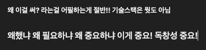
*교수님 미팅 일지 기록 중 일부. 필요성 어필을 강조하셨다.*

개발자 입장에서는 무엇을 어떻게 만들지가 먼저 떠오르는데, 교수님은 처음부터 끝까지 왜를 물으셨다. 이때 기획은 문제를 찾고 어떻게 해결할지가 전부가 아니라, 결국 다른 사람들이 봤을 때 이걸 왜 써야 하는지를 설득하는 게 중요하다는 걸 느꼈다. 그런데 그게 정말 어려웠다. 사실상 전시 직전까지 이걸 어떻게 표현할지 다 같이 고민할 정도로, 구현만큼이나 큰 과제였다.

### 두 번째·세 번째 미팅

두 번째 미팅에서는 실시간 회의를 구현해서 보여 드렸다. 기능이 실제로 돌아가는 걸 보여 드렸지만 피드백은 첫 미팅과 같았다. 아직 서비스를 써야 할 이유가 약하다는 것이다.

세 번째 미팅에서는 GitHub를 연결해서 보여 드렸다. 이번에는 좀 나아졌다는 말을 들었지만 서비스가 필요한 이유를 더 명확히 하라는 피드백이 또 이어졌다. 기능은 미팅마다 늘어나는데 같은 질문에는 여전히 답을 못 하고 있다는 느낌이라, 솔직히 이때가 제일 막막했다.

### 네 번째 미팅

이번에는 코드와 회의를 연동해서 보여 드렸고 이제야 슬슬 필요성을 인정받았다.

대신 새 과제가 생겼다. 이걸 3분 안에 발표하라는 것이었다. 처음 보는 사람이 의도와 필요성, 그러니까 내가 이걸 왜 써야 하는지를 명확히 이해하면서 지루해하지도 않아야 한다. 그래서 전시 발표 시나리오를 짜서 다음 미팅 때 보여 드리기로 했다. 이 고민은 아래 서비스 소개로 이어진다.

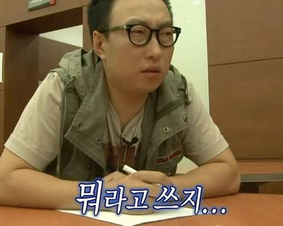
*진짜로 어떻게 해야 할지 감도 안 오고 머리 아픈 이미지 (출처: MBC 〈무한도전〉)*

### 마지막 미팅 - 전시 1, 2주 전

이용 흐름을 쭉 보여 드리고 발표도 한 번 해 보였다. 교수님 반응은 이랬다.

> 이젠 더 할 거 없을 듯 하네요? 정말 수고했고, 전시까지 조금만 더 화이팅합시다^^  여러분 팀이 안 싸우고 화목해 보여서 다행이에요~ 허허

그래도 마지막까지 강조하신 건 같았다. 왜 했고 무엇을 했는지 이해시킬 것, 그리고 짧게 끊어서 말할 것.

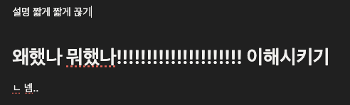
*마지막 교수님 미팅 일지 기록 중 일부. 심지어 마지막 미팅 때도 강조하셨다*

사실 교수님은 서비스 의도를 바로 눈치챘지만, 우리에게 깨달음을 일깨워주려 하신듯하다... ( 아아 이제야 깨달아요 )

## 프로젝트 진행

### 개발

나는 실시간 회의와 인프라 쪽을 맡았다. 실시간 회의를 구현한 이야기는 [시리즈](../whylog-voice-sfu/)에서 주로 다뤘고 인프라는 간단하게 구성해서 여기서는 넘어간다.

### 회의

회의는 대면으로, 주로 내가 주도해서 진행했다. 서로 동기부여도 되고 소속감도 생기도록 대면 회의를 원칙으로 했다. 진행 상황 보고 → 개선할 것·결정할 것·진행 방향 논의 → 다음 회의까지 할 일 정리 순서로 진행했다.

다들 적극적으로 의견을 내 주고 할 일도 미루지 않고 잘 해 왔다. 진행이 더디거나 고민이 있는 부분은 공유해서 어떻게 풀어 갈지 서로 열심히 이야기한, 의미 있는 자리였다.

시간을 맞추다 보니 어쩔 수 없이 늦은 시간에, 그것도 학교에서 대면으로 하게 됐는데 불평불만 없이 잘 따라와 줘서 고마웠다( 아마도... ).

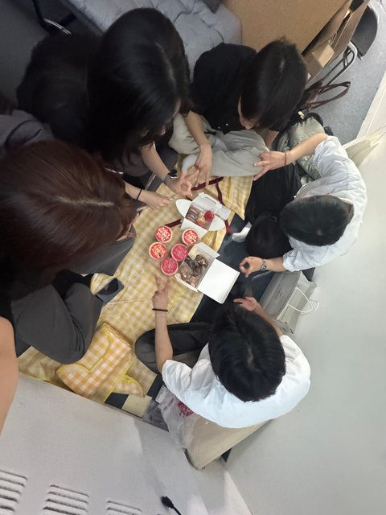
*회의 맞습니다*

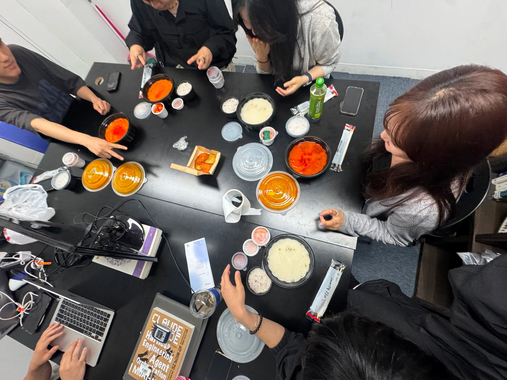
*회의 테이블에서 회식*

중간중간 회식도 했다. 어느 날 회의 뒤에 회식하던 때인데, 고깃집 사장님의 축복이 끊이지 않았던 한 끼였다. 기억에 남아서 하나 남겨본다.

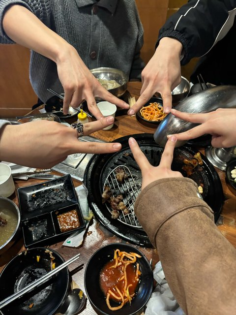

## 정산

프로젝트 내용으로 보면 부가적인 이야기일 수도 있지만 영수증으로 정산하는 걸 처음 해 봤다. 매우 귀찮고 번거롭지만 정말 꼼꼼하게 챙겨야 한다는 걸 깨달았다.

학교에서 프로젝트 지원비를 주고 이걸 쓴 뒤에 영수증을 첨부해서 정산 신청을 해야 한다. 그런데 실물 영수증 뿐 아니라 온라인 영수증도 내야햇고, 각 서류(영수증)에 적힌 내용도 제각각이라 증빙하기가 어려웠다. 하지만 학교 입장에서는 이걸 정확하게 처리해야 하니 어쩔 수 없는 일이었다. 어쩌면 나중에 직장에서 해야 할일을 미리 경험해 본 게 아닐까 하는 생각도 든다.

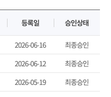
*힘겹게 얻어 낸 최종 승인들… 지원비 관련 교내 관계자들에게도 감사의 인사를 드립니다 🙏* 

## 시연 준비

### 서비스 소개

지도교수님의 주요 지시사항 중 하나였던 설득력 있는 소개, 그중에서도 서비스 한 줄 소개를 정해야 했다.

정말 무수한 고민과 후보들 끝에 **"회의에서 커밋까지, 의사결정 맥락을 추적하는 AI 협업 플랫폼"** 이라는 소개 문구를 뽑았다. 힘들었지만 교수님께 칭찬을 받았다. 이후에 이 문구를 GitHub, 전시 배너, 팜플렛, 영상 등 여러 곳에 활용했다.

### 팜플렛

전시에서 사람들에게 보여 줄 팜플렛은 팀원 한 명이 야무지게 만들어 줬다. 팜플렛에는 서비스 소개를 비롯해 문제 상황을 어떻게 해결했는지를 기능 중심으로 담았다. 다 같이 받으러 갔는데, 받고 나니 프로젝트가 정말 끝나 간다는 게 실감 났다.

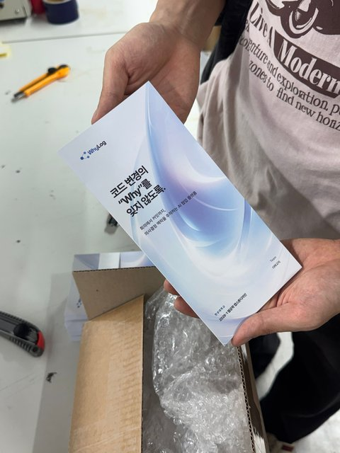

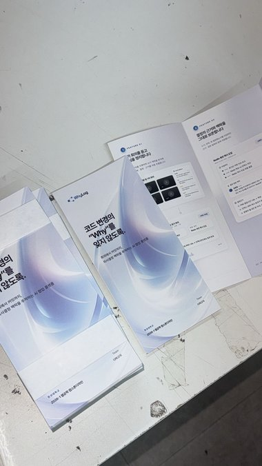

팜플렛 뿐 아니라 디자인과 영상을 담당한 우리 팀원에게 무한한 리스펙 드립니다...

### 전시 기능 테스트

전시 전에 신경 쓴 게 하나 더 있다. 기능 테스트, 그중에서도 실시간 회의다. 소음, 텍스트 출력과 분석 정확도, 실시간성 등 신경 써야 할 경우가 너무 많아서 테스트를 몇 번이고 했다. 그래서 각자 집에서 실시간 회의를 테스트하는 날이 많았다. 아래는 마지막으로 대본을 짜고 했던 실시간 회의 테스트다.

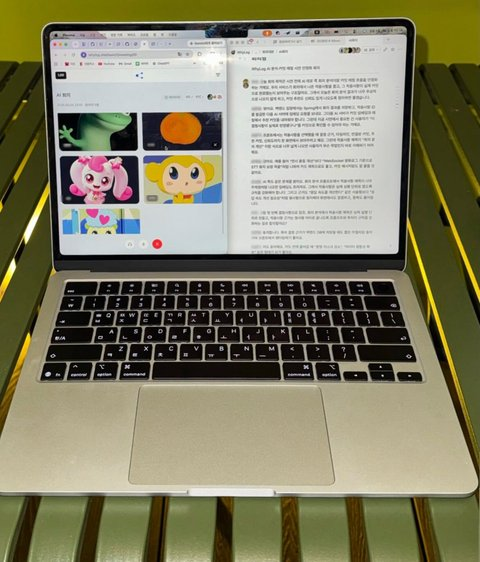

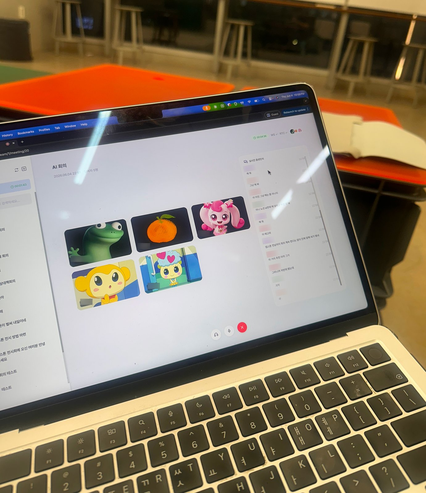

*이 날은 정말... 배꼽 나가게 웃었습니다 진짜*

## 전시

팀원 모두 준비한 시나리오대로 발표 연습을 잘 했고 실제로 부스에 온 사람들에게도 준비한 대로 잘 진행됐다. 덕분에 좋은 말을 많이 들었다. 사실 솔직한 피드백도 기대했는데 그런 이야기는 없어서 살짝 아쉬웠다.

다행히 전시는 잘 마무리했다. 아침부터 준비하고 북적이는 곳에서 다들 정신없이 고생해 줬다.

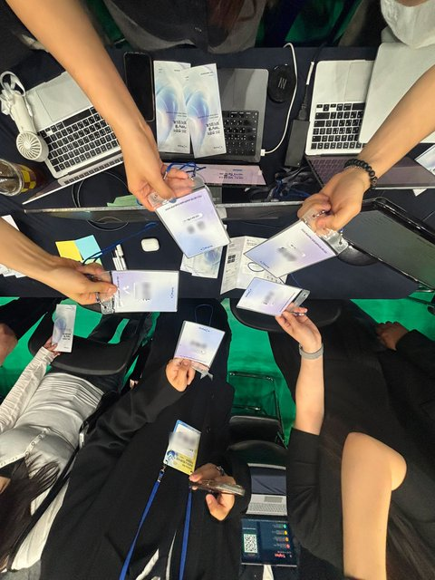

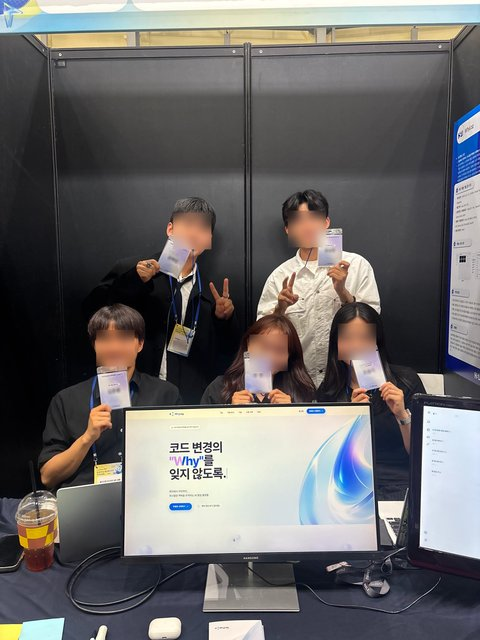

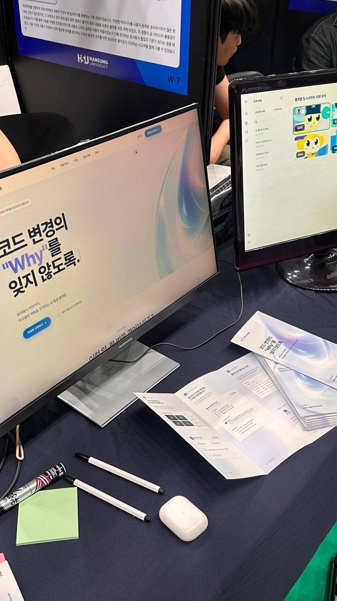
*전시 세팅*

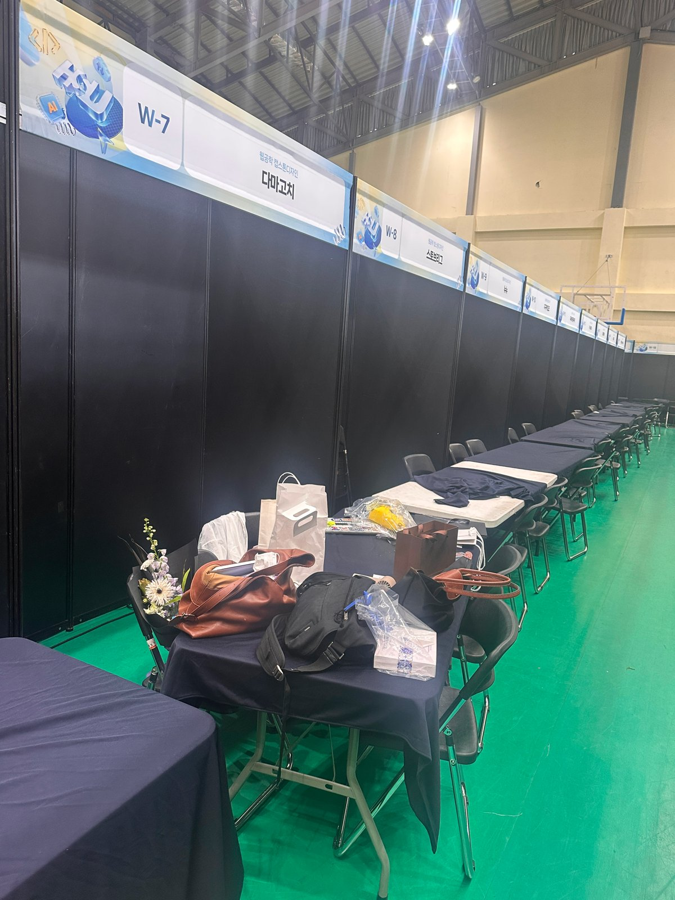
*전시 후 정리 완료*

끝나고 나서 동아리방에서 단체 기절했다.

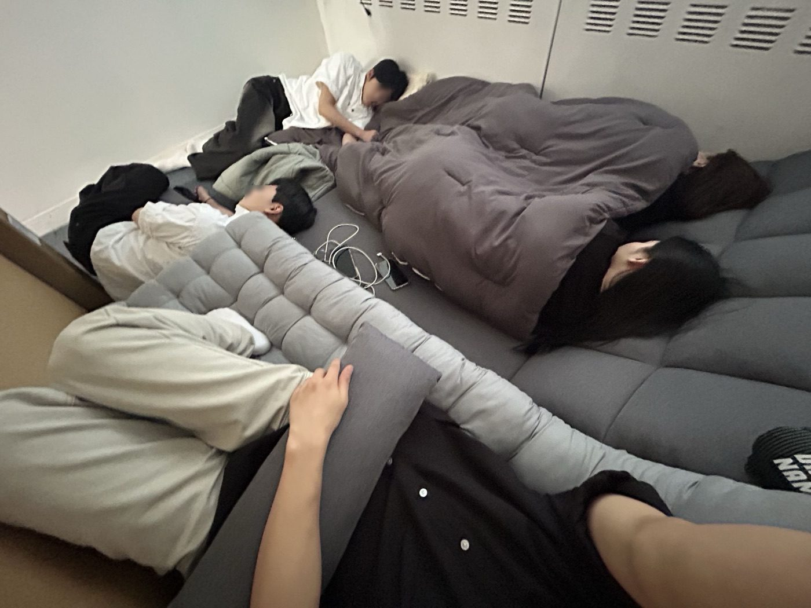

그리고 회식까지 야무지게 마무리했다 😋

## 느낀점

이 프로젝트를 하며 느낀 건 크게 두 가지다.

### 잘 만드는 것보다 쓰고 싶게 만드는 것

첫째, 서비스는 잘 만드는 게 전부가 아니라 내가 만든 걸 사람들이 쓰고 싶게 만드는 게 중요하다는 것이다.

교수님 미팅을 돌아보면 이게 가장 잘 보인다. 실시간 회의를 붙이고 GitHub를 연결하면서 미팅마다 기능은 하나씩 늘었다. 그런데 매번 같은 피드백이 나왔다. 이걸 왜 써야 하는가. 필요성을 인정받은 건 코드와 회의를 연동해 보여 드린 네 번째 미팅이었다. 기능이 많아져서라기보다 회의와 코드가 이어지는 모습에서 이 서비스가 왜 있어야 하는지가 드러났기 때문이라고 생각한다.

그 뒤로 이어진 숙제도 3분 안에 이해시키는 발표, 한 줄로 설명하는 소개 문구, 처음 보는 사람이 봐도 알 수 있는 팜플렛처럼 계속 같은 방향이었다. 결국 마지막까지 붙잡고 있던 건 기능보다 "왜"를 전달하는 일이었다. 개발자로서는 만드는 데 먼저 손이 가지만 만든 걸 쓰고 싶게 만드는 것도 서비스를 만드는 일의 큰 부분이라는 걸 이번에 제대로 느꼈다.

### 기획도 개발을 돕는다

둘째, 기획 또한 개발하는 데 큰 도움이 된다는 것이다.

프로젝트를 진행하며 개발만큼 고민을 많이 한 부분은, 내가 생각한 서비스를 다른 사람들도 이해할 수 있도록 구조화하여 정리하고, 이를 화면에서 어떻게 잘 보여줄 수 있을까 고민하는 것이었다. 개발만 할 때는 이미 잘 정리된 기획과 화면을 받아서 어떻게 구현할지만 고민하면 됐다. 이번에는 그 정리를 직접 해야 했다. 머릿속에 있던 서비스를 개념과 흐름으로 나눠 흐름도로 옮기고 다시 와이어프레임으로 화면까지 그려 보면서 처음에는 보이지 않던 빈 곳들이 하나씩 드러났다.

이 경험은 이후 다른 프로젝트에서도 이어졌다. 개발을 할 때든 기획을 할 때든, 가진 정보를 상황에 맞게 정리하는 것부터 하게 됐다. 직접 구현할 때는 무엇을 어떤 흐름으로 만들지 먼저 정리해 두고 개발했다. 다른 사람과 공유할 때는 듣는 사람이 이해하기 쉬운 형태로 다시 정리해서 전달했다. WhyLog에서 서비스를 흐름도와 와이어프레임으로 옮겨 보며 연습한 게 그대로 도움이 됐다.

**무엇을·어떻게·왜 만드는지 먼저 정리해두고, 다른 사람들에게 잘 공유하는 흐름은 결국 동일했다.**

### 그리고

나는 이 팀이 만들어진 시작점에 있던 사람 중 한 명이었다. 그래서 이 사람들을 책임져야 한다는 생각이 컸다. 기획도, 사실상 PM 역할도 처음이라 나부터 부담스러웠지만 그 부담을 팀원들에게 떠넘기고 싶지는 않았다. 낯선 분야인 만큼 더 잘 해내야겠다는 생각으로 내 나름대로 최선을 다했다.

스스로 생각해도 조금 부족한 부분은 있었다. 그래도 우리 대박 팀원들이 옆에서 같이 힘내 준 덕분에 나도 이 프로젝트에 끝까지 임할 수 있었다. 같이 고생하고 웃었던 시간을 좋은 기억으로 남길 수 있어 좋다. 우리 팀원들 수고 많았다~

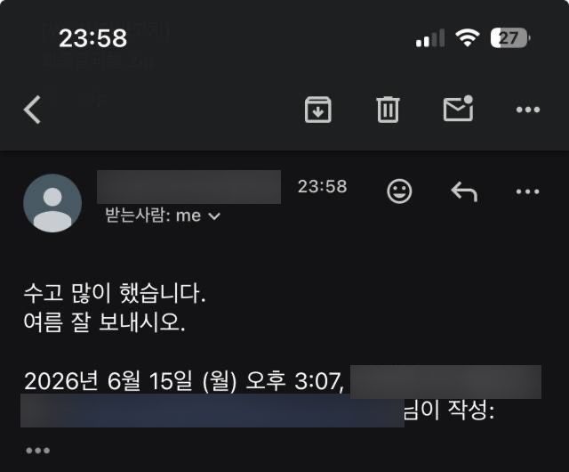
*교수님의 마지막 메일*

-끝-