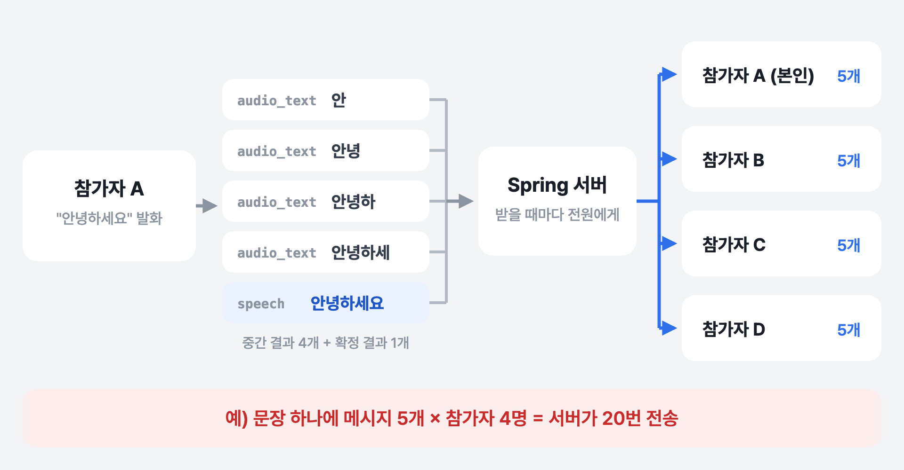
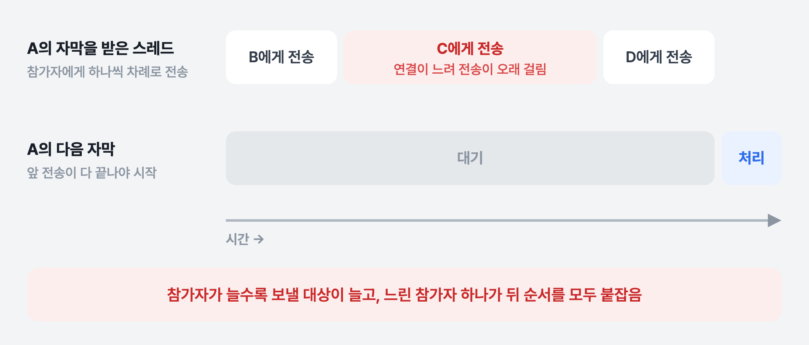
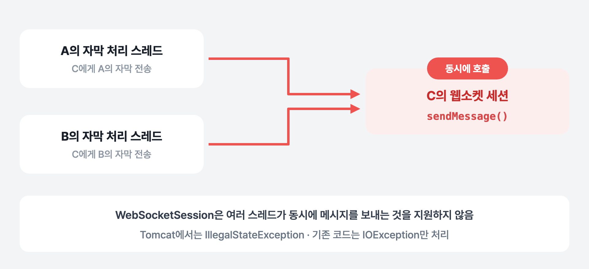
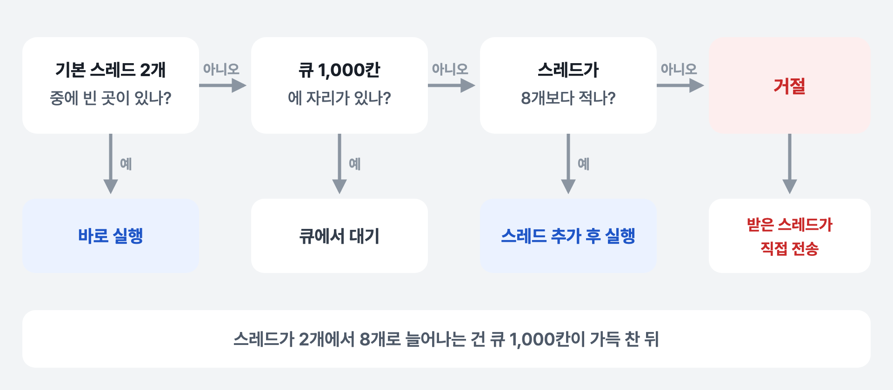
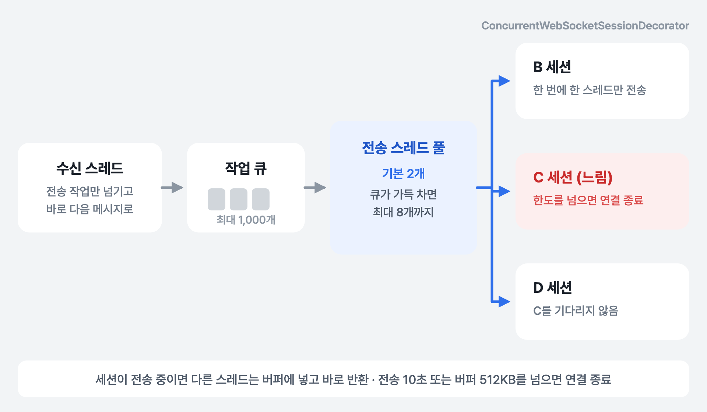

[1편](../whylog-voice-sfu/)에서 음성은 LiveKit SFU로 보내고, 자막·채팅·참가자 목록 같은 텍스트는 Spring 서버의 웹소켓으로 주고받도록 역할을 나눴습니다. 이번 글은 그 웹소켓 쪽 이야기입니다. 자막을 참가자 모두에게 보내는 구조가 참가자가 늘수록 느려지는 문제가 있었고, 이를 고친 과정을 정리했습니다.

## 자막이 서버를 거쳐 가는 길

WhyLog의 실시간 자막은 브라우저에서 만듭니다. 각 참가자의 브라우저가 Web Speech API로 자기 목소리를 텍스트로 바꿔 웹소켓으로 보내면, 서버가 보낸 사람 정보를 붙여 회의방의 모든 참가자에게 다시 뿌립니다.

음성 인식은 말이 끝날 때까지 기다리지 않습니다. 말하는 동안 인식 결과가 바뀔 때마다 **중간 결과(`audio_text`)** 를 내보내고, 말이 끝나면 **확정 결과(`speech`)** 를 줍니다. 화면은 중간 결과를 같은 줄에서 계속 바꿔 보여 주다가 확정 결과가 오면 자막 목록에 한 줄로 추가합니다. 자막이 말과 거의 동시에 바뀌어 보이려면 이 중간 결과가 빨리 전달되어야 합니다.



*문장 하나가 서버에서 여러 번의 전송이 된다*

문장 하나에도 메시지가 여러 개 나오고, 서버는 메시지마다 참가자 전원에게 보냅니다. 참가자가 늘면 들어오는 메시지도 늘고 보낼 대상도 같이 늘어납니다.

## 원인: 받은 스레드가 하나씩 직접 보낸다

개선 전에는 메시지를 받으면 그 자리에서 참가자를 순회하며 한 명씩 보냈습니다.

```java
// 메시지를 받은 스레드에서 그대로 실행됨
private void broadcast(Long meetingId, ...) {
    MeetingRoomRepository room = getRoom(meetingId);
    for (MeetingParticipant participant : room.participants()) {
        sendMessage(participant, message);   // 한 명씩 차례로, 보낼 때마다 블로킹
    }
}

private boolean sendMessage(MeetingParticipant participant, WebSocketMessage<?> message) {
    try {
        participant.socketSession().sendMessage(message);
        return true;
    } catch (IOException exception) {        // IOException만 처리
        return false;
    }
}
```

코드만 보면 문제가 없어 보이지만, 이 코드가 **어느 스레드에서 실행되는지**를 보면 세 가지 문제가 보입니다.

### 1. 참가자가 늘수록 메시지 하나 처리가 길어진다

`handleTextMessage()`는 메시지를 받은 웹소켓 컨테이너(Tomcat) 스레드에서 실행되고, 이 스레드가 그대로 참가자 수만큼 `sendMessage()`를 호출합니다. `sendMessage()`는 데이터가 소켓에 써질 때까지 기다리는 블로킹 호출이라, 메시지 하나를 처리하는 시간이 참가자 수에 비례해 늘어납니다.

게다가 한 세션에서 들어온 메시지는 순서대로 처리되기 때문에, 이 브로드캐스트가 끝나기 전까지 **같은 사람이 보낸 다음 자막은 처리를 시작하지 못합니다.** 중간 결과가 연달아 들어오는 자막에서는 이 대기가 계속 쌓입니다.

### 2. 느린 참가자 한 명이 뒤 순서를 모두 붙잡는다

참가자 중 한 명의 네트워크가 느리면 그 사람에게 보내는 `sendMessage()`가 오래 걸리고, 순서대로 보내는 구조라 그 뒤에 있는 참가자들은 앞 사람 전송이 끝날 때까지 기다려야 합니다.



*순서대로 보내는 구조 — C 한 명이 느리면 D와 다음 자막까지 늦어진다*

### 3. 같은 세션에 여러 스레드가 동시에 보낼 수 있다

A와 B가 동시에 말하면 A의 메시지를 처리하는 스레드와 B의 메시지를 처리하는 스레드가 동시에 돌고, 둘 다 C에게 자막을 보내야 하니 **C의 세션 하나에 두 스레드가 동시에 `sendMessage()`를 호출**하게 됩니다.



*발화자가 둘 이상이면 같은 세션에 동시 전송이 생긴다*

Spring의 `WebSocketSession`은 여러 스레드가 동시에 메시지를 보내는 것을 지원하지 않습니다. Tomcat에서는 이미 전송 중인 세션에 또 보내려고 하면 `IllegalStateException`이 나는데, 기존 코드는 `IOException`만 잡고 있어서 이 예외는 처리되지 않고 그대로 위로 올라가는 구조였습니다.

정리하면 **"받은 스레드가, 참가자를 하나씩, 보호 장치 없이 직접 보내는 것"** 이 문제였습니다.

## 해결

### 1. 세션마다 동시 전송 보호 장치 씌우기

Spring은 이 상황을 위해 `ConcurrentWebSocketSessionDecorator`를 제공합니다. 세션을 감싸서 한 번에 한 스레드만 실제로 보내게 하고, 다른 스레드가 보내려고 하면 메시지를 버퍼에 넣고 바로 돌아오게 합니다. 버퍼에 쌓인 메시지는 지금 보내고 있는 스레드가 이어서 보냅니다. 웹소켓이 연결될 때 참가자 세션을 이 데코레이터로 감싸서 저장했습니다.

```java
private WebSocketSession decorate(WebSocketSession session) {
    return new ConcurrentWebSocketSessionDecorator(
            session,
            10_000,       // 전송이 10초 넘게 걸리거나
            512 * 1024    // 쌓인 메시지가 512KB를 넘으면 → 세션 종료
    );
}
```

두 한도가 중요합니다. 느린 참가자의 버퍼가 끝없이 커지면 서버 메모리가 버티지 못하니, 한도를 넘으면 그 세션을 끊습니다. **느린 한 명 때문에 나머지 전체가 늦어지는 대신, 그 한 명만 연결이 끊기도록** 바꾼 것입니다.

### 2. 전송은 별도 스레드 풀에서

메시지를 받은 스레드는 전송 작업만 스레드 풀에 넘기고 바로 돌아오게 했습니다. 그래야 같은 사람의 다음 자막을 곧바로 처리할 수 있습니다.

```java
public void broadcastText(Long meetingId, String payload) {
    dispatch(() -> broadcast(meetingId, ...));   // 전송은 스레드 풀에 맡기고 바로 반환
}

private void dispatch(Runnable task) {
    try {
        meetingSocketDispatchExecutor.execute(task);
    } catch (RuntimeException exception) {
        task.run();   // 풀이 거절하면 메시지를 버리지 않고 받은 스레드가 직접 보냄
    }
}
```

스레드 풀은 `ThreadPoolTaskExecutor`로 기본 스레드 2개, 최대 8개, 큐 1,000칸으로 설정했습니다. 여기서 헷갈리기 쉬운 점이 하나 있습니다. 스레드가 8개까지 늘어나는 건 바쁠 때가 아니라 **큐가 가득 찬 뒤**입니다.



*ThreadPoolTaskExecutor가 작업을 받는 순서*

그래서 평소에는 스레드 2개가 전송을 맡고, 큐 1,000칸이 넘칠 만큼 몰릴 때만 늘어납니다. 그것마저 넘치면 위 `dispatch()`의 `catch`로 들어가 받은 스레드가 직접 보냅니다.

### 3. 순회는 복사본으로, 예외는 넓게

전송이 여러 스레드에서 돌면서, 한 스레드가 참가자 목록을 순회하는 동안 다른 스레드에서 입장·퇴장이 일어날 수 있게 됐습니다. 그래서 순회는 그 시점의 목록을 복사해서 돌고, 전송 실패는 모든 예외를 잡아 끊긴 세션으로 정리하도록 바꿨습니다.

```java
// 그 시점의 참가자 목록을 복사해서 순회
for (MeetingParticipant participant : new ArrayList<>(room.participants())) { ... }

// 전송 실패는 모든 예외를 잡아 끊긴 세션으로 정리
try {
    participant.socketSession().sendMessage(message);
} catch (Exception exception) {   // IOException → Exception
    return false;
}
```

세 가지를 합친 구조는 이렇습니다.



*바뀐 구조 — 받는 일과 보내는 일을 나누고, 세션마다 보호 장치를 둠*

## 바뀐 점

| | 개선 전 | 개선 후 |
|---|---|---|
| 전송하는 스레드 | 메시지를 받은 스레드 | 전송 전용 스레드 풀 |
| 같은 사람의 다음 자막 | 앞 브로드캐스트가 끝날 때까지 대기 | 바로 처리 |
| 느린 참가자 | 뒤 순서 참가자 전체가 대기 | 그 세션만 버퍼에 쌓이고, 한도를 넘으면 연결 종료 |
| 같은 세션 동시 전송 | 보호 없음 (`IllegalStateException` 가능) | 한 번에 한 스레드만 전송 |
| 전송 실패 처리 | `IOException`만 처리 | 모든 예외를 끊긴 세션으로 정리 |

## 남은 한계

**메시지 순서가 바뀔 수 있습니다.** 전송 스레드가 2개 이상이라, 같은 사람이 연달아 보낸 자막 두 개가 서로 다른 스레드에 잡히면 나중 메시지가 먼저 도착할 수 있습니다. 중간 결과라면 "안녕하"가 보였다가 "안녕"으로 잠깐 되돌아가는 식입니다. 순서를 지키려면 회의방마다 작업을 한 줄로 세워 처리하는 방식(회의방별 단일 스레드 큐 등)이 필요합니다.

**중간 결과가 너무 자주 옵니다.** 인식 결과가 바뀔 때마다 보내니 메시지 수 자체가 많습니다. 일정 간격으로 묶어서 보내면 전송량을 더 줄일 수 있습니다.

**서버가 한 대라는 전제입니다.** 회의방과 참가자 세션을 서버 메모리에서 관리하기 때문에, 서버를 여러 대로 늘리면 다른 서버에 붙은 참가자에게는 메시지가 가지 않습니다. 확장하려면 Redis Pub/Sub 같은 메시지 중계가 필요합니다.

## 정리

- 웹소켓 브로드캐스트를 **메시지를 받은 스레드에서 동기로** 하면, 참가자 수만큼 처리 시간이 늘고 느린 참가자 한 명이 전체를 붙잡습니다.
- `WebSocketSession.sendMessage()`는 **동시에 호출하면 안전하지 않습니다.** 여러 사람이 동시에 말하는 회의에서는 반드시 생기는 상황이라, `ConcurrentWebSocketSessionDecorator` 같은 보호 장치가 필요합니다.
- 보호 장치에는 **한도**가 있어야 합니다. 한도가 없으면 느린 참가자 대신 서버 메모리가 문제가 됩니다.

다음 글에서는 이 자막을 회의 기록으로 저장하다가 "안녕하세요"가 "안, 안녕, 안녕하…"로 저장되던 문제를 다룹니다.
