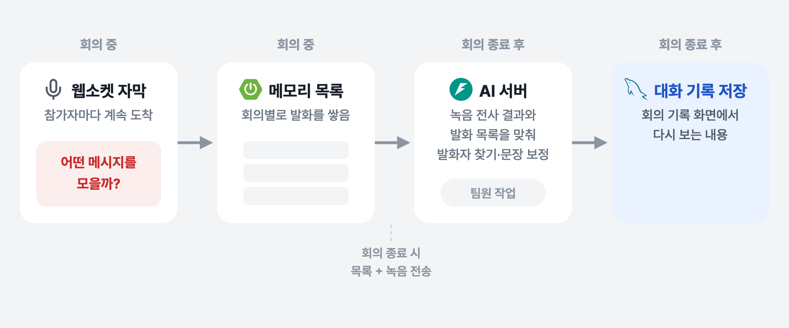
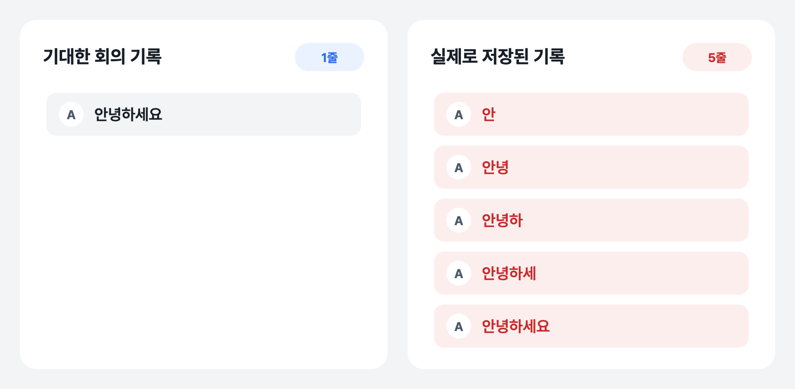
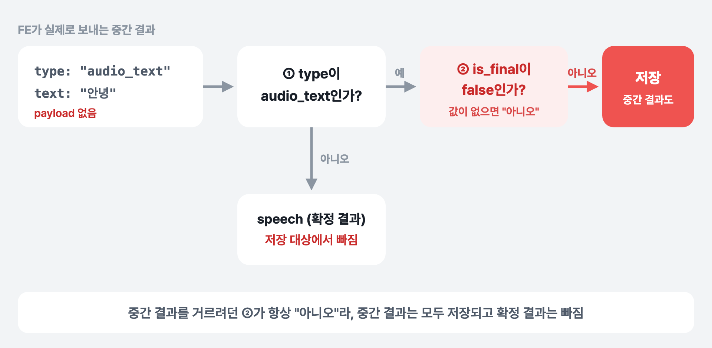

[2편](../whylog-subtitle-broadcast/)에서는 실시간 자막을 참가자 모두에게 빠르게 보내는 문제를 다뤘습니다. 이번에는 그 자막을 회의가 끝난 뒤에도 볼 수 있게 **회의 기록으로 저장**하는 쪽 이야기입니다. 저장 기능을 붙이고 나니 회의 기록에 "안녕하세요" 한 문장이 "안", "안녕", "안녕하", "안녕하세", "안녕하세요" 다섯 줄로 남는 문제가 있었습니다.

## 회의 기록이 만들어지는 과정

WhyLog는 회의가 끝나면 녹음 파일과 실시간 발화를 함께 분석해 회의 기록을 만듭니다.



*회의 기록이 만들어지는 과정 — 문제는 첫 단계, "어떤 메시지를 모으느냐"에 있었다*

1. **회의 중**: 서버는 웹소켓으로 들어오는 자막 메시지 중 일부를 회의별 메모리 목록에 쌓습니다.
2. **회의 종료**: 쌓아 둔 목록을 JSON으로 묶어 녹음 파일과 함께 AI 서버로 보냅니다.
3. **AI 서버**: 녹음을 텍스트로 바꾼 결과와 발화 목록을 시간·순서·문장 유사도로 맞춰 보고, 누가 한 말인지 찾고 문장을 보정합니다. 이 부분은 AI 담당 팀원의 작업입니다.
4. 그 결과가 **대화 기록**으로 저장되어 회의 기록 화면에 보입니다.

발화 목록은 AI 서버가 "누가 무슨 말을 했는지" 판단하는 기준 자료입니다. 그래서 이 목록에 무엇이 들어가느냐가 회의 기록의 품질을 좌우합니다.

## 문제: 문장 하나가 다섯 줄로 저장됐다

한 사람이 한 번 말한 문장이, 글자가 하나씩 늘어나는 조각으로 회의 기록에 여러 줄 저장됐습니다.



*기대한 기록과 실제로 저장된 기록*

조각의 모양만 봐도 원인이 짐작됩니다. 실시간 음성 인식의 **중간 결과**가 그대로 저장된 것입니다.

## 원인: 서버가 기대한 값을 클라이언트는 보내지 않았다

2편에서 정리했듯이 자막 메시지는 두 종류입니다. 말하는 도중 인식 결과가 바뀔 때마다 오는 **중간 결과(`audio_text`)** 와, 말이 끝나 문장이 확정됐을 때 오는 **확정 결과(`speech`)** 입니다.

발화 목록을 처음 만들 때 저장 조건은 이랬습니다.

```java
// 자막을 브로드캐스트한 뒤, 조건에 맞으면 발화 목록에 저장
if (type == MeetingMessageType.AUDIO_TEXT
        && StringUtils.hasText(incoming.text())
        && !isInterim(incoming.payload())) {
    meetingLiveMessageRepository.append(participant.meetingId(), new LiveMessageEntry(...));
}

// payload의 is_final이 false면 중간 결과로 보고 저장하지 않음
private static boolean isInterim(JsonNode payload) {
    if (payload == null) {
        return false;
    }
    JsonNode isFinal = payload.get("is_final");
    return isFinal != null && isFinal.isBoolean() && !isFinal.booleanValue();
}
```

`audio_text`를 저장하되, `payload`의 `is_final` 값이 `false`인 중간 결과는 거르겠다는 의도였습니다. 그런데 프론트엔드가 실제로 보내는 메시지에는 `payload`가 없었습니다.

```ts
// FE: 웹소켓으로 자막을 보낼 때
ws.send(JSON.stringify({ type, text }));
```

프론트엔드는 처음부터 중간 결과는 `audio_text`, 확정 결과는 `speech`로 **타입을 나눠서** 보내고 있었고, 따로 `is_final` 값을 담지 않았습니다. 그래서 서버의 조건은 이렇게 동작했습니다.



*저장 조건이 실제 메시지를 만났을 때*

- `payload`가 없으니 `isInterim()`은 항상 `false`를 돌려줍니다. 중간 결과를 거르려던 조건이 **한 번도 걸리지 않고** 모든 중간 결과가 저장됐습니다.
- 반대로 정작 저장해야 할 **확정 결과(`speech`)는 타입 조건에서 빠져** 저장 대상이 아니었습니다.

목록에 넣을 때 바로 앞 발화와 보낸 사람·문장이 모두 같으면 건너뛰는 중복 제거도 넣어 두었지만, 이 처리는 **글자가 완전히 같은 경우**만 거릅니다. "안녕"과 "안녕하"는 서로 다른 문장이라 그대로 통과했습니다.

정리하면, 서버는 "중간 결과에는 `is_final: false`가 붙어 온다"고 가정했고 클라이언트는 "타입으로 구분한다"고 약속하고 있었습니다. 둘이 다른 약속을 보고 있었고, 값이 없을 때 `false`를 돌려주는 방어 코드 때문에 에러 없이 조용히 틀린 데이터가 쌓였습니다.

## 해결: 확정 결과만 저장한다

클라이언트가 이미 타입으로 중간 결과와 확정 결과를 나누고 있으니, 서버도 그 약속을 그대로 따르도록 바꿨습니다. 저장 대상을 확정 결과인 `speech`로 바꾸고, `is_final` 검사는 지웠습니다.

```java
if (type == MeetingMessageType.SPEECH          // AUDIO_TEXT → SPEECH
        && StringUtils.hasText(incoming.text())) {  // is_final 검사 제거
    meetingLiveMessageRepository.append(participant.meetingId(), new LiveMessageEntry(...));
}
```

타입은 모든 메시지에 반드시 들어 있는 값이라, 있을 수도 없을 수도 있는 `payload` 필드에 기대지 않아도 됩니다. 화면에 자막을 보내는 브로드캐스트는 그대로 두었습니다. 중간 결과는 계속 실시간 자막 표시에만 쓰입니다.

| | 화면에 실시간 표시 | 회의 기록용 목록 (수정 전) | 회의 기록용 목록 (수정 후) |
|---|---|---|---|
| `audio_text` (중간 결과) | 표시 | **저장됨** (조각이 쌓임) | 저장 안 함 |
| `speech` (확정 결과) | 표시 | **저장 안 됨** | 저장 |

수정 뒤에는 문장 하나가 회의 기록에 한 줄로 남습니다.

## 남은 것

**발화 목록은 서버 메모리에만 있습니다.** 회의가 끝날 때까지 메모리에 쌓아 두는 구조라, 회의 도중 서버가 재시작되면 그때까지 모은 목록은 사라집니다. 회의가 길어지거나 서버를 여러 대로 늘리려면 Redis 같은 외부 저장소로 옮겨야 합니다.

## 정리

- 실시간 음성 인식은 **중간 결과와 확정 결과**를 따로 내보냅니다. 화면 표시에는 중간 결과가 필요하지만, 기록으로 남길 건 확정 결과입니다.
- 클라이언트와 서버가 **메시지를 구분하는 기준을 서로 다르게 알고 있으면**, 조건문은 에러 없이 조용히 무력해집니다. 서버가 기대하는 필드가 실제로 오는지는 실제 메시지로 확인해야 합니다.
- 판단 기준은 **항상 들어 있는 값**(여기서는 `type`)으로 잡는 편이 안전합니다. 없으면 기본값으로 넘어가는 필드에 기대면, 이번처럼 "거르는 조건"이 "다 통과시키는 조건"이 됩니다.
