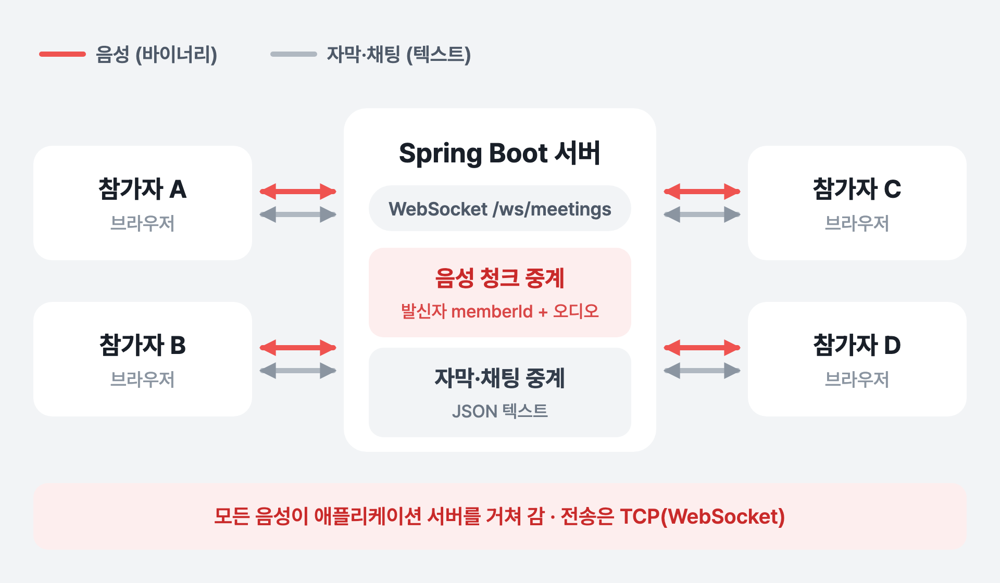
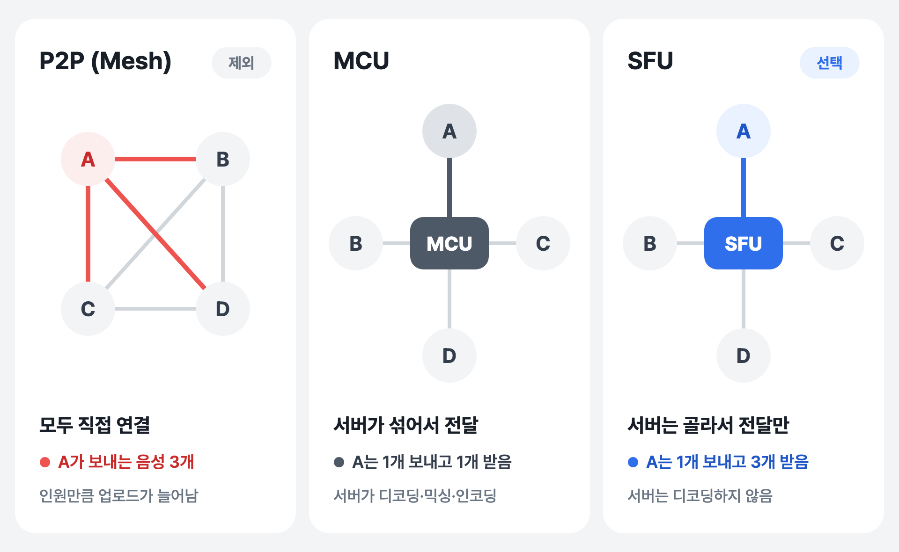
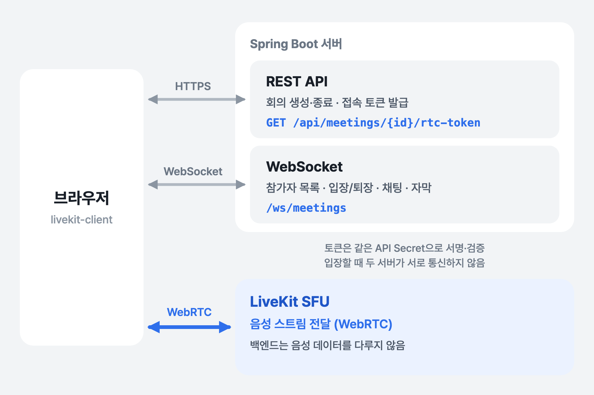
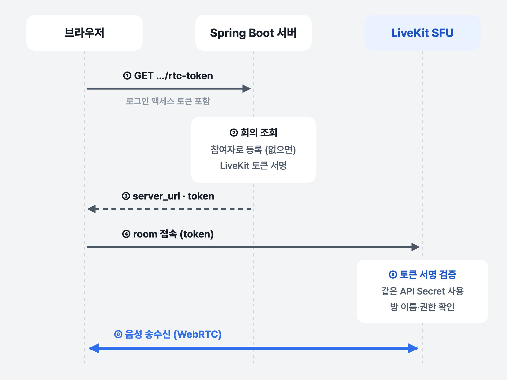

[WhyLog](https://github.com/WhyLog-App/WhyLog-BE)는 회의에서 나온 논의와 결정을 GitHub 커밋·PR과 연결해 "왜 이렇게 개발했는지"를 남기는 협업 서비스입니다. 팀원들이 서비스 안에서 음성으로 회의를 하고, 말한 내용은 자막으로 실시간 표시되며, 회의가 끝나면 그 기록을 분석해 결정 사항을 뽑아냅니다.

저는 백엔드에서 이 실시간 회의 기능을 맡았습니다. 실시간 회의에 필요한 건 크게 세 가지였습니다.

- 여러 명이 동시에 음성으로 대화하기
- 말한 내용(자막)과 채팅을 모든 참가자에게 전달하기
- 누가 들어오고 나갔는지 참가자 목록 맞추기

이 글은 그중 첫 번째, **음성을 어떤 경로로 전달할지**를 두 번 설계한 이야기입니다.

## 처음 구조: 웹소켓 하나로 음성까지 중계

처음에는 회의용 웹소켓 엔드포인트(`/ws/meetings`) 하나로 모든 걸 처리했습니다. 텍스트 프레임으로는 자막·채팅 같은 JSON 메시지를, 바이너리 프레임으로는 브라우저가 녹음한 오디오 조각(청크)을 주고받았습니다.



*처음 구조 — 음성도 텍스트와 같은 웹소켓으로 서버가 중계*

서버는 오디오 청크를 받으면 앞에 보낸 사람의 `memberId`(8바이트)를 붙여서, 보낸 사람을 뺀 나머지 참가자에게 그대로 뿌렸습니다. 받는 쪽은 앞 8바이트로 누구 목소리인지 구분합니다.

```java
// 클라이언트가 보낸 오디오 청크를 발신자 memberId와 함께 다른 참가자들에게 중계
@Override
protected void handleBinaryMessage(WebSocketSession session, BinaryMessage message) {
    MeetingParticipant participant = createParticipant(session);
    ByteBuffer outbound = ByteBuffer.allocate(Long.BYTES + message.getPayloadLength());
    outbound.putLong(participant.memberId());          // 앞 8바이트: 보낸 사람
    outbound.put(message.getPayload().asReadOnlyBuffer()); // 나머지: 오디오
    outbound.flip();

    meetingSocketRoomService.broadcastAudio(participant.meetingId(), participant.sessionId(), outbound);
}
```

```java
// 발신자를 제외한 나머지 참가자에게 오디오 청크 전달
public void broadcastAudio(Long meetingId, String senderSessionId, ByteBuffer payload) {
    broadcast(
            meetingId,
            participant -> new BinaryMessage(payload.asReadOnlyBuffer()),
            participant -> participant.sessionId().equals(senderSessionId) // 본인은 제외
    );
}
```

연결 하나로 음성과 텍스트를 모두 처리할 수 있어서 구현은 단순했습니다. 다만 이 구조를 실제 회의에 쓰려면 짚어야 할 점이 있었습니다.

## 웹소켓 음성 중계의 한계

### 1. TCP 위에서 음성을 보낸다

웹소켓은 TCP 위에서 동작합니다. TCP는 패킷이 하나 빠지면 다시 받을 때까지 뒤에 도착한 패킷도 애플리케이션에 넘기지 않습니다(Head-of-Line Blocking). 파일 전송이라면 당연히 그래야 하지만, 실시간 음성에서는 0.1초 전 소리를 다시 받느라 지금 소리까지 늦어지는 셈입니다. 실시간 음성은 늦게 온 조각을 버리고 다음 소리를 재생하는 편이 낫고, 그래서 WebRTC는 UDP 위에서 미디어를 보냅니다.

### 2. 음성 처리를 직접 만들어야 한다

오디오 청크를 바이트로 주고받는 것만으로는 회의가 되지 않습니다. 압축(코덱), 도착 간격이 들쭉날쭉한 조각을 고르게 재생하기 위한 버퍼, 네트워크 상태에 따른 품질 조절을 모두 직접 구현해야 합니다. WebRTC를 쓰면 브라우저가 이 부분(Opus 코덱, 지터 버퍼, 혼잡 제어 등)을 이미 처리해 줍니다.

### 3. 애플리케이션 서버가 모든 음성을 떠안는다

참가자가 N명이면 서버는 음성 N개를 받아 N×(N−1)개를 내보냅니다. 4명이면 4개를 받아 12개를, 8명이면 8개를 받아 56개를 보냅니다. 로그인, 회의 관리, DB 처리를 하는 같은 Spring 서버가 이 음성 트래픽까지 계속 중계해야 합니다.

정리하면 음성은 텍스트와 같은 길로 보낼 게 아니라, **실시간 미디어 전용 경로(WebRTC)로 분리**해야 했습니다. 그래서 프론트엔드와 실시간 회의를 연동하기 전에 음성 경로를 다시 설계했습니다.

## WebRTC로 여러 명을 연결하는 세 가지 방법: P2P, MCU, SFU

WebRTC로 여러 명을 연결하는 방식은 크게 세 가지입니다.



*4명 기준 P2P(Mesh), MCU, SFU 비교*

**P2P(Mesh)** 는 참가자끼리 모두 직접 연결합니다. 중간에 미디어 서버가 없어서 둘이 통화할 때는 가장 단순합니다. 하지만 N명이면 1명이 자기 음성을 N−1번 따로 인코딩해서 보내야 하고, 전체 연결 수는 N(N−1)/2개가 됩니다. 인원이 늘수록 각자의 업로드 대역폭과 CPU 부담이 같이 늘어납니다.

**MCU(Multipoint Control Unit)** 는 모두 미디어 서버 하나와 연결하고, 서버가 받은 음성을 전부 디코딩해 하나로 섞은 뒤(믹싱) 다시 인코딩해서 보냅니다. 참가자는 1개 보내고 섞인 1개만 받으니 클라이언트는 가장 가볍습니다. 대신 서버가 참가자 수만큼 디코딩하고 믹싱·인코딩까지 해야 해서 서버 CPU 부담이 크고, 그 처리 시간만큼 지연이 더해집니다. 섞인 소리 하나만 오기 때문에 클라이언트에서 참가자별로 음량을 조절하는 것처럼 음성을 따로 다루기도 어렵습니다.

**SFU(Selective Forwarding Unit)** 도 모두 미디어 서버 하나와 연결합니다. 각자 음성을 서버에 한 번만 올리고, 서버는 그 음성을 디코딩하거나 섞지 않고 필요한 참가자에게 그대로 전달합니다. 받는 음성은 N−1개로 같지만, **올리는 음성은 인원과 관계없이 1개**입니다.

WhyLog는 팀 단위 회의가 기본이라 여러 명이 동시에 들어오는 상황을 전제로 해야 했습니다. 그래서 인원에 따라 업로드가 늘어나는 P2P(Mesh)는 설계 단계에서 제외했습니다. 남은 MCU와 SFU 중에서는 서버가 음성을 디코딩·믹싱하지 않아 서버 부담이 작고, 참가자별 음성이 따로 전달되는 SFU를 선택했습니다.

| | 웹소켓 서버 중계 | P2P (Mesh) | MCU | SFU |
|---|---|---|---|---|
| 전송 | TCP | UDP (WebRTC) | UDP (WebRTC) | UDP (WebRTC) |
| 1명당 올리는 음성 | 1개 | N−1개 | 1개 | 1개 |
| 1명당 받는 음성 | N−1개 | N−1개 | 1개 (섞인 것) | N−1개 |
| 서버가 하는 일 | 그대로 중계 | 없음 | 디코딩·믹싱·인코딩 | 골라서 전달 |
| 코덱·버퍼·품질 조절 | 직접 구현 | WebRTC가 처리 | WebRTC가 처리 | WebRTC가 처리 |

SFU 서버는 직접 만들지 않고 [LiveKit](https://livekit.io)을 사용했습니다.

### LiveKit이란

LiveKit은 WebRTC로 실시간 음성·영상 서비스를 만들 수 있게 해 주는 오픈소스 플랫폼입니다. 중심에는 Go로 작성된 SFU 서버가 있고, 이 서버를 직접 띄워 쓰거나 관리형 서비스(LiveKit Cloud)를 쓸 수 있습니다. 브라우저·모바일용 클라이언트 SDK와 방 관리·녹화용 서버 API도 함께 제공해서, SFU를 직접 구현하지 않고 "방을 만들고, 들어가고, 음성을 주고받는" 수준으로 다룰 수 있습니다.

LiveKit을 쓰려면 개념 세 가지만 알면 됩니다.

| 개념 | 뜻 | WhyLog에서는 |
|---|---|---|
| Room | 참가자가 모이는 방 | 회의 1개 = 방 1개 (`meeting-1` 형식) |
| Participant | 방에 들어온 사람. `identity`로 구분 | identity = 회원 ID |
| Track | 참가자가 올리는(publish) 음성·영상 스트림. 다른 참가자는 이를 구독(subscribe)해서 받음 | 각자의 마이크 음성 트랙 |

그리고 방에 들어가려면 **접속 토큰**이 필요합니다. 아무나 방에 들어오면 안 되니, 서버가 "이 사람은 이 방에 들어와도 된다"고 서명한 토큰을 들고 와야 입장할 수 있습니다. 이 토큰을 발급하는 게 바로 아래에서 다룰 백엔드의 새 역할입니다.

## 역할 나누기: 백엔드는 음성을 다루지 않는다

SFU를 도입하면서 연결을 세 갈래로 나눴습니다.



*바뀐 구조 — 음성은 LiveKit, 나머지는 Spring 서버*

| 경로 | 담당 | 하는 일 |
|---|---|---|
| REST API | Spring 서버 | 회의 생성·종료, LiveKit 접속 토큰 발급 |
| WebSocket `/ws/meetings` | Spring 서버 | 참가자 목록, 입장·퇴장 알림, 채팅, 자막 텍스트, 회의 종료 알림 |
| WebRTC | LiveKit SFU | 음성 스트림 전달 |

백엔드는 더 이상 음성 데이터를 받지 않습니다. 웹소켓으로 오디오 바이너리가 들어오면 중계하지 않고 에러로 돌려보내도록 바꿨습니다.

```java
// 실시간 오디오는 WebRTC/SFU 경로로 전달하고, 웹소켓 바이너리 프레임은 더 이상 중계하지 않음
@Override
protected void handleBinaryMessage(WebSocketSession session, BinaryMessage message) {
    sendError(session, "Binary audio relay over WebSocket is not supported. Use WebRTC transport for live audio.");
}
```

대신 백엔드가 새로 맡은 일이 하나 생겼습니다. **이 사용자가 이 회의의 음성 방에 들어가도 되는지 증명하는 토큰을 발급하는 것**입니다.

## LiveKit 접속 토큰 발급

LiveKit에 접속하려면 접속 토큰이 필요합니다. 이 토큰은 LiveKit API Secret으로 서명한 JWT이고, 안에 "누가(identity), 어느 방에(room), 무엇을 할 수 있는지(권한)"가 들어갑니다. LiveKit 서버는 같은 Secret으로 서명만 검증하면 되기 때문에, 사용자가 입장할 때 우리 서버에 다시 물어볼 필요가 없습니다.



*회의 음성 방에 입장하는 순서*

브라우저는 먼저 우리 서버에 토큰을 요청합니다. 이 요청은 일반 API처럼 로그인 액세스 토큰으로 인증됩니다.

```java
@GetMapping("/meetings/{meetingId}/rtc-token")
public ApiResponse<MeetingResponse.MeetingRtcTokenDTO> issueRtcToken(
        @CurrentMember Long memberId,
        @PathVariable Long meetingId
) {
    return ApiResponse.onSuccess(meetingRtcService.issueRtcToken(memberId, meetingId));
}
```

서버는 회의를 확인하고, 아직 이 회의의 참여자가 아니면 참여자로 등록한 뒤 토큰을 만듭니다.

```java
@Transactional
public MeetingResponse.MeetingRtcTokenDTO issueRtcToken(Long memberId, Long meetingId) {
    Meeting meeting = meetingRepository.findById(meetingId)
            .orElseThrow(MeetingNotFoundException::new);
    Member member = memberUseCase.findMemberById(memberId);

    ensureMeetingParticipant(meeting, member);           // 참여자가 아니면 등록
    String roomName = "meeting-" + meeting.getId();      // 회의 1개 = LiveKit room 1개
    String identity = String.valueOf(member.getId());    // LiveKit 참가자 = 회원
    String token = createJoinToken(identity, member.getName(), roomName);

    return MeetingResponse.MeetingRtcTokenDTO.builder()
            .meetingId(meetingId)
            .roomName(roomName)
            .serverUrl(liveKitUrl)
            .token(token)
            .build();
}
```

토큰은 LiveKit이 정한 형식대로 JWT를 직접 만듭니다.

```java
private String createJoinToken(String identity, String name, String roomName) {
    Date now = new Date();
    Date expiration = new Date(now.getTime() + liveKitTokenExpireTime);

    Map<String, Object> videoGrant = Map.of(
            "roomJoin", true,        // 방 입장
            "room", roomName,        // 이 방에만
            "canPublish", true,      // 내 음성 올리기
            "canSubscribe", true,    // 다른 사람 음성 받기
            "canPublishData", true   // 데이터 메시지 보내기
    );

    return Jwts.builder()
            .setIssuer(liveKitApiKey)   // API Key
            .setSubject(identity)       // 참가자 식별자
            .setIssuedAt(now)
            .setNotBefore(now)
            .setExpiration(expiration)
            .claim("name", name)        // 화면에 보일 이름
            .claim("video", videoGrant) // 권한
            .signWith(Keys.hmacShaKeyFor(liveKitApiSecret.getBytes(StandardCharsets.UTF_8)))
            .compact();
}
```

몇 가지 정한 규칙이 있습니다.

- **방 이름은 `meeting-{회의 ID}`** 로 고정했습니다. 회의와 LiveKit 방이 1:1로 대응하니 따로 매핑 테이블이 필요 없습니다.
- **identity에는 회원 ID**를 넣었습니다. LiveKit 쪽 참가자를 바로 우리 회원과 연결할 수 있습니다.
- **권한은 해당 방으로 제한**했습니다. 토큰에 `room`이 들어 있어서 다른 회의 방에는 들어갈 수 없습니다.
- **API Secret은 서버에만** 둡니다. 브라우저는 서명된 토큰만 받습니다.

브라우저는 응답으로 받은 `server_url`과 `token`으로 LiveKit 클라이언트 SDK를 통해 방에 접속하고, 이후 음성은 LiveKit과 직접 주고받습니다.

```json
{
  "meeting_id": 1,
  "room_name": "meeting-1",
  "server_url": "wss://livekit.example.com",
  "token": "eyJhbGciOiJIUzI1NiJ9..."
}
```

## 정리

| | 처음 | 바꾼 뒤 |
|---|---|---|
| 음성 전달 | Spring 서버가 웹소켓(TCP)으로 중계 | LiveKit SFU가 WebRTC(UDP)로 전달 |
| 백엔드 역할 | 음성·텍스트 모두 중계 | 접속 토큰 발급 + 텍스트 메시지 |
| 전송 | TCP | UDP |
| 음성 처리 | 직접 구현 필요 | WebRTC·LiveKit이 처리 |

음성을 전용 경로로 떼어 내면서 Spring 서버는 음성 트래픽에서 빠지고, 인증과 회의 상태 관리라는 원래 역할에 집중할 수 있게 됐습니다. 백엔드가 하는 일은 "이 사람이 이 방에 들어가도 된다"는 서명을 해 주는 것으로 줄었습니다.

그렇다고 웹소켓이 할 일이 없어진 건 아닙니다. 자막과 채팅, 참가자 목록은 여전히 웹소켓으로 오가는데, 이 텍스트 전송도 참가자가 늘수록 느려지는 구조였습니다. 다음 글에서는 실시간 자막 전송 병목을 다룹니다.
